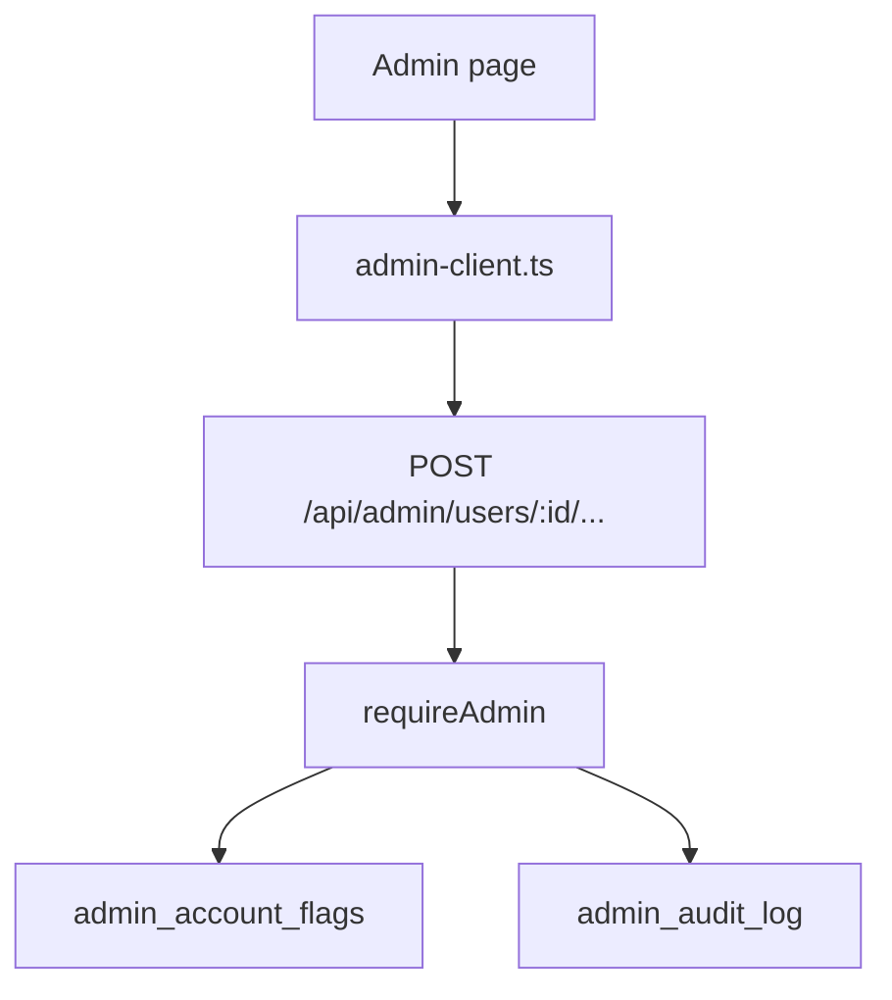

# Admin domain

Admin is the operator dashboard. It exists in cloud mode only. `requireAdmin` gates every `/api/admin` route.

## Admin member list

**App domain:** Admin

The admin page loads a summary and a member list.

| Role | Path | Function |
| --- | --- | --- |
| Page | `src/app/admin/page.tsx` | Admin page |
| Client | `src/lib/admin-client.ts` | `getAdminSummary`, `getAdminUsers`, `getAuditLog` |
| API | `api/src/routes/admin.ts` | `GET /summary`, `GET /users`, `GET /audit` |
| Gate | `api/src/lib/admin.ts` | `makeRequireAdmin`, `isAdmin` |

`LECTOR_ADMIN_EMAILS` is the allow list. A non-admin gets 403.

Each row shows plan, status, last active, library size, and month usage.

## Admin trends

**App domain:** Admin

The Trends section shows daily totals for 7, 30 or 90 days.

| Role | Path | Function |
| --- | --- | --- |
| Page | `src/app/admin/Trends.tsx` | Trends section |
| Client | `src/lib/admin-client.ts` | `getAdminTrends` |
| API | `api/src/routes/admin.ts` | `GET /trends?days=7\|30\|90` |
| Logic | `api/src/lib/admin-trends.ts` | `buildAdminTrends` |

It counts only totals. Admin and billing-exempt accounts are left out.

- Active learners and lookups come from `dailyStats`, which uses each learner's time zone.
- Signups, Free AI translations (`usage_counters`) and RMB orders (`cn_orders`) use UTC days.
- Paid AI calls are counted per month only, so the chart leaves them out.

## Product email switch

**App domain:** Admin

One switch turns every lifecycle mail on or off. Auth mail ignores it.

| Role | Path | Function |
| --- | --- | --- |
| API | `api/src/routes/admin.ts` | `GET /email-switch`, `PUT /email-switch` |
| Setting | `api/src/lib/app-settings.ts` | `productEmailsSetting`, `setProductEmails` |
| Sender | `api/src/lib/lifecycle-email.ts` | `sweepLifecycleEmails` |

The value lives in `app_settings`. Until an admin sets it, `LIFECYCLE_EMAILS=1` turns the mail on. Each change writes a `product_emails` row to the audit log. The send rules are in [Auth](auth.md#lifecycle-email).

## Anonymous source counts

**App domain:** Admin

The Trends page lists visits and sign-ups per traffic source. The counts hold no user id, IP, referrer URL or user agent.

| Role | Path | Function |
| --- | --- | --- |
| Visit | `api/src/routes/source-count.ts` | `POST /api/source-count` |
| Store | `api/src/lib/source-counts.ts` | `recordSourceEvent`, `sourceReport` |
| Report | `api/src/lib/admin-trends.ts` | `buildAdminTrends` (`sources`) |

- The visit route is public. The session and billing gates skip it.
- It skips bots and requests that carry a session cookie. The limiter allows 20 per minute for each visitor address (`X-Forwarded-For`) and 600 per minute for the whole route.
- A sign-up count (`signup`) is written by the sign-up hooks from the first-visit cookie.
- A row is one count per UTC date, source, language group and event, in `source_counts`.
- The browser maps the referrer host (or `utm_source`) to a name on a fixed list (`SOURCES` in `src/lib/traffic-source.ts`): search engines, AI assistants, social and community sites, `email`, `campaign` (an unmatched `utm_source`), `other` (an unknown host) and `direct`. No raw host is sent or stored.
- The browser language maps to a fixed group (`LANGS`): 16 languages and `other`.
- `api/src/lib/source-list.ts` mirrors both lists. The route answers 400 for any value off the list. A parity test keeps the two copies equal.
- Rows written before the lists grew keep their old values (`zh` or `other`; `other` for sites now named). Nothing is migrated.

## Admin support action

**App domain:** Admin

Each support write hits the audit log.

| Action | Client | Route |
| --- | --- | --- |
| Suspend | `suspendUser` | `POST /users/:id/suspend` |
| Restore | `restoreUser` | `POST /users/:id/restore` |
| Comp | `compUser` | `POST /users/:id/comp` |
| Uncomp | `uncompUser` | `POST /users/:id/uncomp` |
| Export | `exportUser` | `GET /users/:id/export` |
| Reset MFA | `resetMfa` | `POST /users/:id/reset-mfa` |
| Password reset | `sendPasswordReset` | `POST /users/:id/password-reset` |
| Resend confirmation | `resendVerification` | `POST /users/:id/resend-verification` |
| Force confirmation | `forceVerify` | `POST /users/:id/verify` |
| Revoke sessions | `revokeSessions` | `POST /users/:id/revoke-sessions` |
| Resync Paddle | `resyncPaddle` | `POST /users/:id/resync-paddle` |

Export uses `buildUserExport`. See [Data](data.md).

Comp writes a flag. It does not create a Paddle row. The entitlements engine treats the flag as a paid plan.

### Tables

`admin_account_flags`, `admin_audit_log`. The unused `admin_impersonation` table stays in the schema.
