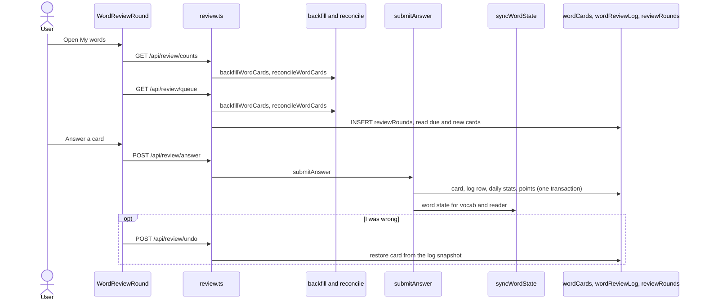
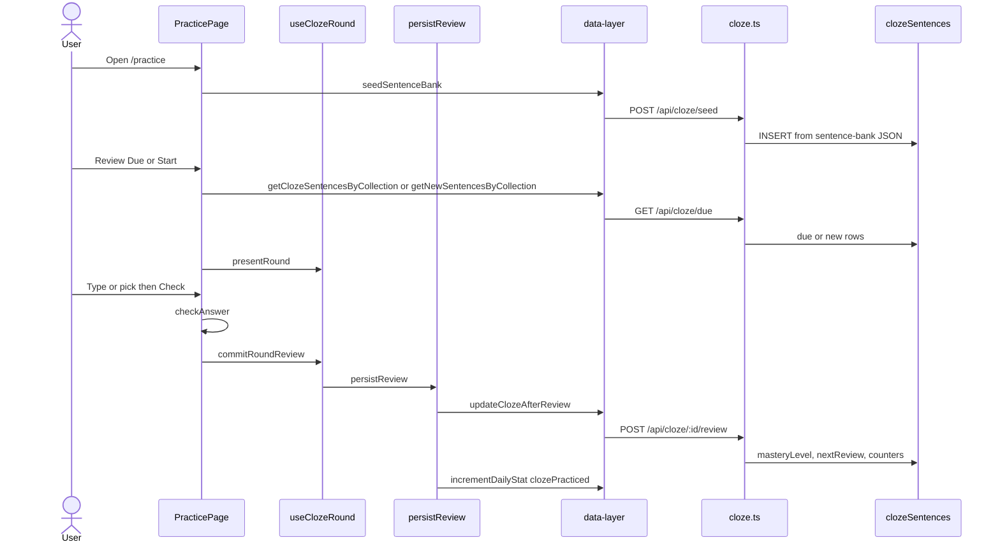

# Practice domain

This domain runs word review, cloze and dictation. Word review cards live in `wordCards`. Cloze cards live in `clozeSentences`. Both use FSRS on the server. A Mastered word also writes the Vocabulary domain.

Intervals in days come from `calculateNextReview`:

| Mastery | Days |
| --- | --- |
| 0 | 0 |
| 25 | 1 |
| 50 | 3 |
| 75 | 7 |
| 100 | 14 |

The table shows the legacy fixed gaps. The server now schedules bank cloze reviews with FSRS (see Bank cloze scheduling below). The client still sends the old body. A correct answer adds 25, cap 100. A miss sets mastery to 0 and re-queues the card in the same round. Retry awards no points. When a mastery 100 card is due, it still appears.

## Word review

**App domain:** Practice

The user opens `/practice` and starts "My words". The server builds a round of due and new word cards. FSRS (ts-fsrs 5.4.2) schedules each answer on the server only. The client never runs FSRS.

### Path

### Key files

| Role | Path | Function |
| --- | --- | --- |
| UI | `src/app/practice/word-review/` | `WordReviewEntry`, `WordReviewRound`, `use-word-review-round.ts`, `questions.ts` |
| Client | `src/lib/data-layer.ts` | `getReviewQueue`, `submitReviewAnswer`, `undoReviewAnswer` |
| API | `api/src/routes/review.ts` | `GET /counts`, `GET /queue`, `POST /answer`, `POST /undo` |
| Queue | `api/src/lib/review/queue.ts` | `buildRound`, `getCounts` |
| Answer | `api/src/lib/review/answer.ts` | `submitAnswer`, `submitUndo` |
| FSRS | `api/src/lib/review/scheduler.ts`, `stages.ts` | rating map, stage from stability |
| Meanings | `api/src/lib/review/meanings.ts` | four meanings for choose-the-meaning |
| Prepare | `api/src/lib/review/backfill.ts`, `reconcile.ts` | `backfillWordCards`, `reconcileWordCards` |

### Rules

- Tables: `wordCards` (one per folded word and language), `wordReviewLog` (append-only answers with the pre-review FSRS snapshot), `reviewRounds` (short-lived, not exported).
- Every `counts` and `queue` request runs `backfillWordCards` and then `reconcileWordCards`. Backfill makes cards for words saved before launch, at their current level, with at most 20 seeded reviews due per day. Reconcile repairs cards after a write that skipped the sync function, such as an older app version on the same database.
- The question type follows the stage and the `reviewGoal` setting (`recognize` or `recognize_spell`). Phrases, Chinese and Korean never get a fill-in.
- A round holds at most 20 new cards per language per learner-local day. Words saved today come first.
- Wrong and Don't know cards come back once per round. "I was wrong" calls `/undo`.
- Choose-the-meaning shows four meanings: the word's own and three from the learner's other saved words. With fewer than three usable distractors, the card becomes a recognition card for that round.
- Stages by stability: New, Learning, Familiar, Mastered. Retention is 0.9. Intervals cap at 365 days.
- Free accounts keep at most 5,000 log rows. Pruning keeps each card's newest row.
- Cards and the log travel with export and restore. Restore skips cards whose word has no saved vocab row.
- Review sentences are described in the next part.

### Review sentences

The saved sentence comes first. After that, a card rotates through free-library sentences and bundled Tatoeba sentences (English dictionary examples and sentence-bank rows). It skips the last sentence shown. Saved words match inflected forms through the dictionary. Phrases match exact tokens. Shorter sentences near the learner's level rank first. Chinese and Korean skip the finder.

- Finder: `api/src/lib/review/sentence-sources.ts`. Index: `api/src/lib/review/sentence-index.ts`. The index uses a per-chapter word filter, about 53 MB for en and fr. It is built on first use.
- Source line: a small line under the sentence. It shows the book and chapter (linking to `/books/<lang>/<slug>`), Tatoeba (the sentence page, or a search link when there is no id), or "AI example".
- Translation follows the cloze hide-translation setting and Alt+T.
- `GET /api/review/queue` stays DB-only and marks pending work. The client then asks for the visible card only.
- `POST /api/review/sentence-translation` and `POST /api/review/example-sentence` take `{roundId, cardId}`. Code: `api/src/lib/review/sentence-ai.ts`.
- Shared caches have no user id: table `shared_sentence_translation` (`api/src/lib/sentence-translation-cache.ts`) and table `shared_example_sentence`, source `ai`, one example per language and word (`api/src/lib/example-sentence-cache.ts`). Both expire after 180 days.
- Both endpoints use the `/localize` burst limits. They do not meter the AI allowance. A learner with their own key uses it and writes nothing shared.
- The server finds the sentence from the card's `lastSentenceKey`. The saved sentence never goes to the model or to a shared table. The AI example request sends only the word and the language name.
- Not built: Tatoeba ids in the English dictionary examples (needs a new dictionary release), and Chinese or Korean fill-in.

### Bank cloze scheduling

`POST /api/cloze/:id/review` keeps its request body. It now schedules from `correct` with server time. The FSRS state of a row is seeded from its legacy mastery and gap when it is empty or older than `lastReviewed`. The route writes the FSRS columns, `masteryLevel` (0/25/75/100 from the stage) and `nextReview` (the FSRS due time). A Mastered bank word becomes known on the server through `syncWordState`. The client no longer writes `knownWords` for it.

### Tables

`wordCards`, `wordReviewLog`, `reviewRounds`, `shared_sentence_translation`, `shared_example_sentence`, `vocab`, `knownWords`, `dailyStats`.

### Tests

`api/src/lib/review/*.test.ts`, `src/app/practice/word-review/__tests__/`.

## Practice word

**App domain:** Practice

The user opens `/practice`, picks a collection, then reviews due cards or learns new cards.

### Path

### Key files

| Role | Path | Function |
| --- | --- | --- |
| Page | `src/app/practice/page.tsx` | `startRoundWith`, `handleSubmit`, `handleMcSelect`, `recordAnswer` |
| Round | `src/app/practice/use-cloze-round.ts` | `useClozeRound`, `clozeRoundReducer`, `commitRoundReview` |
| Persist | `src/app/practice/persist-review.ts` | `persistReview` |
| Grade | `src/app/practice/utils.ts` | `checkAnswer`, `normalize`, `calculateNextReview`, `calculatePoints`, `createBlankedSentence`, `buildMultipleChoiceOptions` |
| Feedback | `src/app/practice/components/Feedback/index.tsx` | `Feedback` |
| Client | `src/lib/data-layer.ts` | `seedSentenceBank`, `getClozeSentencesByCollection`, `getNewSentencesByCollection`, `updateClozeAfterReview` |
| API | `api/src/routes/cloze.ts` | `POST /seed`, `GET /due`, `GET /counts`, `POST /:id/review` |
| Bank | `api/src/lib/sentence-bank-*.json` | `loadSentenceBank` |
| Tokens | `api/src/lib/languages.ts` | `resolveClozeTokens` |
| Punct | `src/lib/words.ts` | `splitTrailingPunctuation` |

`GET /due` modes:

- `mode=new`: `reviewCount = 0`
- `mode=review`: `nextReview <= now` and `reviewCount > 0`. This includes mastery 100.
- else: `nextReview <= now`

Blacklisted rows stay out. Order is random.

### Branches

- The Type or MC mode lives in `localStorage` key `cloze-practice-mode`.
- Type mode can fall back to MC mode for one card. The next card returns to type.
- If `persistReview` fails, the round does not advance.
- Word-state and daily-stat writes are best effort after a saved review.
- Punctuation after the word sits outside the blank. The grade step strips it. The known-word write also strips it.
- The seed step copies rows from Tatoeba in the JSON bank. The seed step also copies mined rows.
- Live `GET /api/tatoeba` is not on this path.
- The UI collections are:
  - `top500`
  - `top1000`
  - `top2000`
- Collection `mined` is for Onboarding only.

### Tables

`clozeSentences`, `knownWords` (written by the server when the word is Mastered), and `dailyStats`.

### Tests

`e2e/practice.spec.ts`, `e2e/mc-fallback.spec.ts`, `e2e/cloze-definitions.spec.ts`. Unit: `src/app/practice/__tests__/use-cloze-round.test.ts`, `persist-review.test.ts`.

## Dictation

**App domain:** Practice

Same SRS persist. The user types the full sentence after TTS.

| Role | Path | Function |
| --- | --- | --- |
| Page | `src/app/practice/page.tsx` | `recordDictation`, `handleSetPracticeFormat` |
| Card | `src/app/practice/components/Dictation/DictationCard.tsx` | `DictationCard` |
| Grade | `src/app/practice/utils.ts` | `diffDictation`, `scoreDictation`, `calculateDictationPoints` |
| Speech | `src/lib/tts.ts` | `speak`, `hasAudio` |

Pass threshold is 0.75. Surrender is always a miss. A pack with `pronunciation.audio: 'none'` hides Dictation.

Tests: `e2e/dictation.spec.ts`.

## Blacklist sentence

**App domain:** Practice

| Role | Path | Function |
| --- | --- | --- |
| Button | `src/app/practice/components/BlacklistSentence/index.tsx` | `handleBlacklist`, `handleUndoBlacklist` |
| Round | `src/app/practice/use-cloze-round.ts` | `blacklistCurrent` |
| Client | `src/lib/data-layer.ts` | `blacklistClozeSentence`, `unblacklistClozeSentence` |
| API | `api/src/routes/cloze.ts` | `PUT /:id` `{ blacklisted }` |

The row stays in the table. Due queries exclude it. Undo does not put the card back in the current round.

## Onboarding cloze

See [Onboarding](onboarding.md). Cards use `source = 'mined'`, `collection = 'mined'`, id `onboarding:{vocabId}`.
