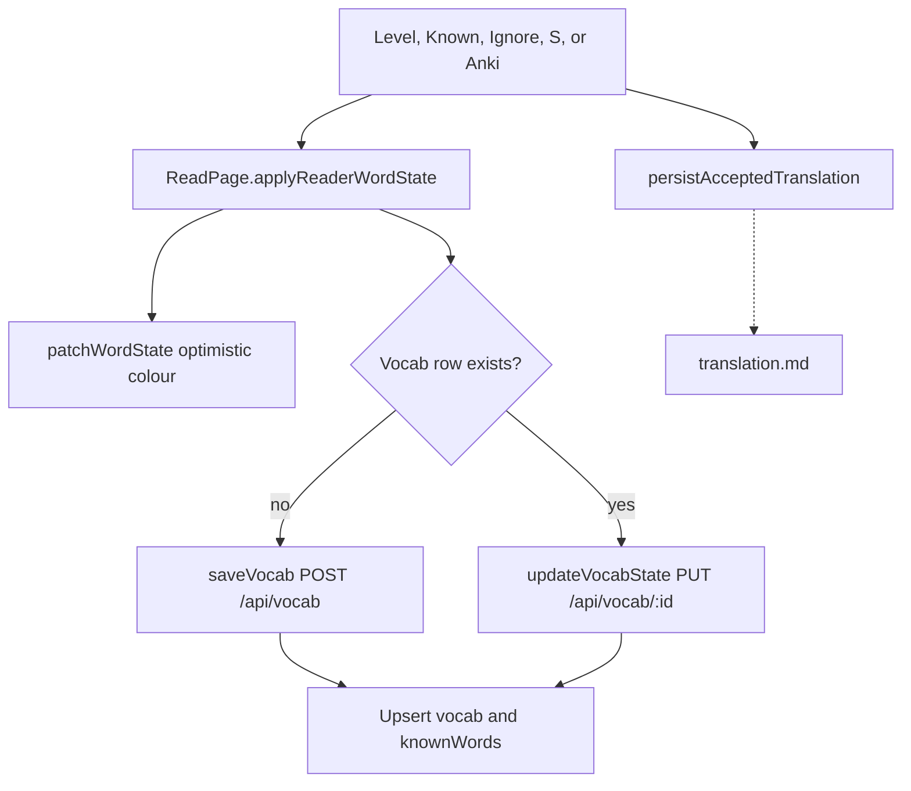
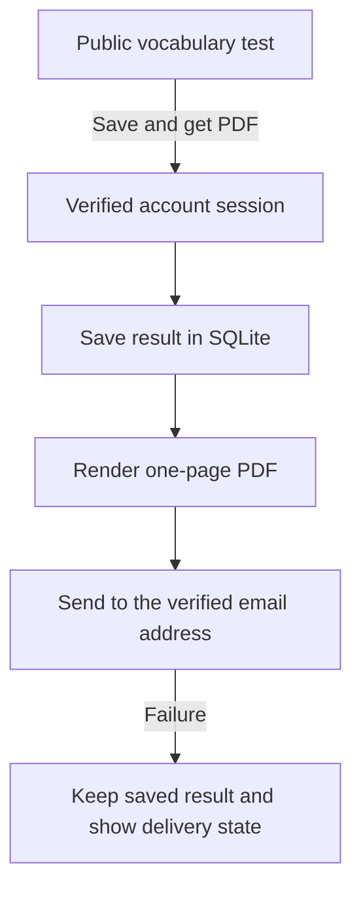

# Vocabulary domain

This domain stores entries that the user owns. It also stores the known-word map. The reader uses `knownWords` for colour. The vocab list uses `vocab`. A save writes both.

## Save vocab and set word state

**App domain:** Vocabulary

There is no Save button. A level, Known, Ignore, keyboard `S`, or Add to Anki creates or updates a row.

### Auto-save of looked-up words

When the setting `autoSaveLookups` is not `false`, the reader saves a looked-up single word once its meaning arrives. The setting loads first. A failed read or an unloaded setting means no auto-save.

- The save is silent. It never changes a word that already has a state, and a failure shows nothing.
- One save runs per word at a time (`createKeyedGuard`). Key `S` pressed during an auto-save does not post a second row.
- The guide lesson and nested lookups do not auto-save.

| Role | Path | Function |
| --- | --- | --- |
| Reader | `src/app/read/[bookId]/page.tsx` | `saveWordToVocab`, `saveWordNow` |
| Rules | `src/lib/auto-save-lookups.ts` | `resolveAutoSave`, `createKeyedGuard` |

Keyboard: `K` marks Known. Keys `1` to `4` set levels. `X` marks Ignore. IME compose skips these keys.

### Key files

| Role | Path | Function |
| --- | --- | --- |
| Reader | `src/app/read/[bookId]/page.tsx` | `setWordLevel`, `markAsKnown`, `ignoreWord`, `saveWordToVocab`, `applyReaderWordState` |
| Colour | `src/components/MarkdownReader/optimistic-word-state.ts` | `patchWordState` |
| Client | `src/lib/data-layer.ts` | `saveVocab`, `updateVocabState`, `getVocabByText` |
| API | `api/src/routes/vocab.ts` | `POST /`, `PUT /:id` |
| Fold | `src/lib/languages.ts` | `foldWord` |

`POST /api/known-words` is not on the drawer path. The reader colours from `GET /api/known-words` at lesson load, then from the optimistic map.

Ignore does not write the translation cache. Known and levels do, for single words with no dict hit. See [translation.md](translation.md#cache-accepted-translation).

A Mastered bank word becomes known on the server: `POST /api/cloze/:id/review` calls `syncWordState`. The client no longer calls `updateWordState` for it.

### Word state writes

`syncWordState` (`api/src/lib/review/sync-word-state.ts`) is the single writer of word state. It writes `vocab.state`, `knownWords` and the word card (`wordCards`) together, by the source of the change:

- `reader`: levels seed the FSRS state. Known or Ignore retires the card.
- `import` and `anki`: an incoming known state keeps a Mastered card active.
- `restore`: the same rule as import.
- `review`: updates every vocab row that folds to the word.

Vocab create, update and delete, the known-words import, Anki back-sync, restore and bank cloze reviews all call it. See [Word review](practice.md#word-review). Do not write `vocab.state` or `knownWords` anywhere else.

### Word states

`new`, `level1`, `level2`, `level3`, `level4`, `known`, `ignored`.

### Tables

`vocab`, `knownWords`, `wordCards`, `dailyStats` (`newWordsSaved`, `wordsMarkedKnown`).

## Vocab list

**App domain:** Vocabulary

| Role | Path | Function |
| --- | --- | --- |
| Page | `src/app/vocab/page.tsx` | `loadData`, `handleUpdateEntry`, `handleDeleteEntry` |
| List | `src/components/VocabList/index.tsx` | `VocabList` |
| Modal | `src/app/vocab/components/VocabDetailModal.tsx` | `handleSave` |
| Client | `src/lib/data-layer.ts` | `getAllVocab`, `updateVocabEntry`, `deleteVocabEntry` |
| API | `api/src/routes/vocab.ts` | `GET /`, `PUT /:id`, `DELETE /:id` |

Filter and page run in memory. `GET /api/vocab` has no `limit`. Delete of the last vocab row for a folded key also deletes `knownWords`.

Tests: `e2e/vocab-edit.spec.ts`, `e2e/vocab-pagination.spec.ts`.

## Known-word import

**App domain:** Vocabulary

Settings, Import Known Words. A plain list writes `knownWords` only. A LingQ CSV also writes `vocab`.

| Role | Path | Function |
| --- | --- | --- |
| UI | `src/app/settings/components/KnownWordsImport/index.tsx` | `importKnownWords`, `importLingQWords` |
| Parse | `src/app/settings/components/KnownWordsImport/utils.ts` | `parseCSVLine`, `lingqStatusToState` |
| Client | `src/lib/data-layer.ts` | `bulkUpdateWordStates`, `saveVocab` |
| API | `api/src/routes/known-words.ts` | `POST /` |

New rows have `domain IS NULL` until the classifier runs. See [stats.md](stats.md).

## Vocabulary test reports

**App domain:** Vocabulary

The public test calculates the result in the browser. It sends a result summary only when a reader chooses to save it to an account. The summary contains the estimate, level, test date and book references. Answers stay in the browser. The report history is private and uses the account session.

The API stores one report for each account and test attempt. The mail path uses a separate record and sends an attachment. An uncertain send uses the same request while the email service can deduplicate it. The reading level action remains separate.
