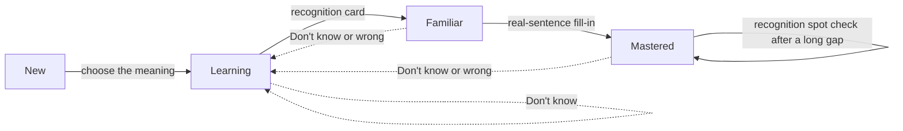
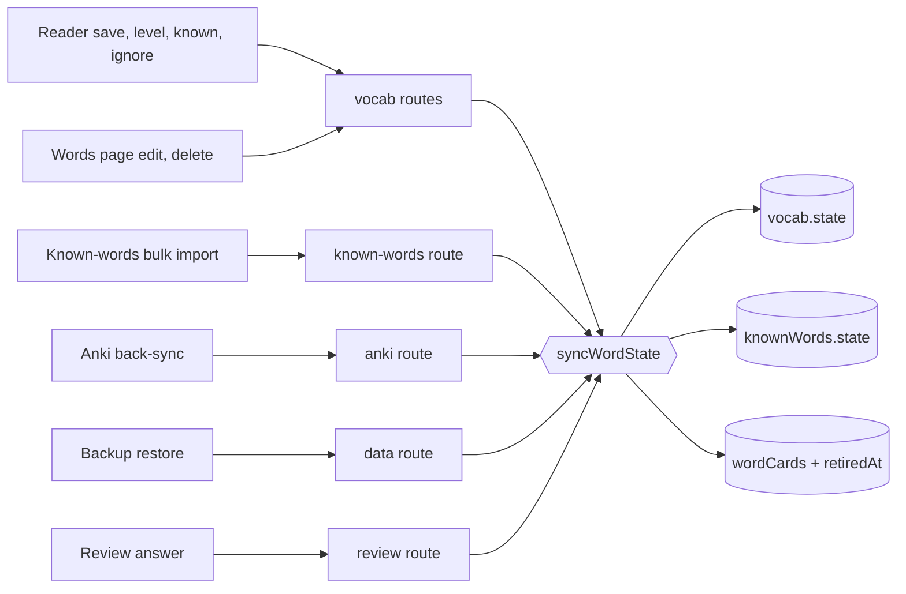
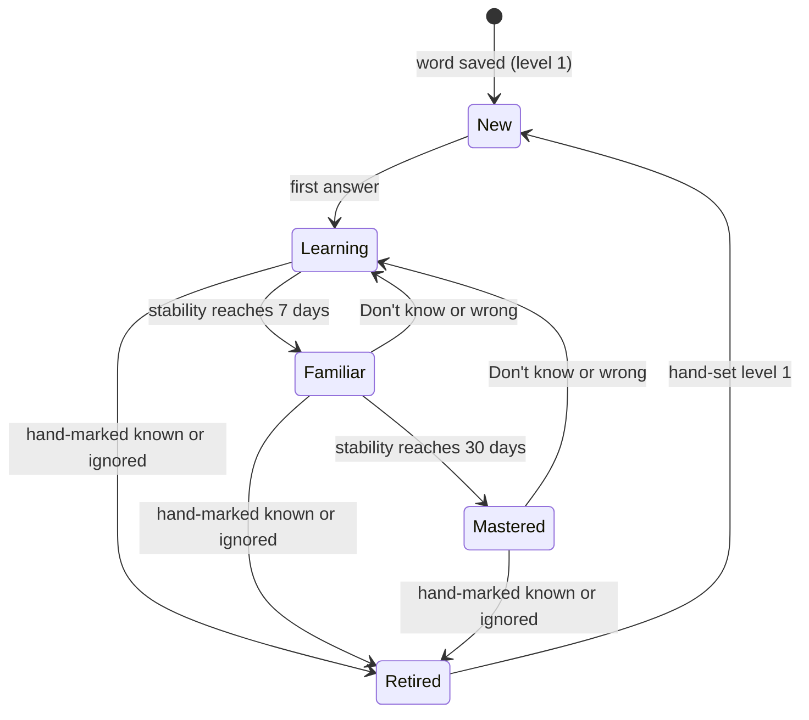
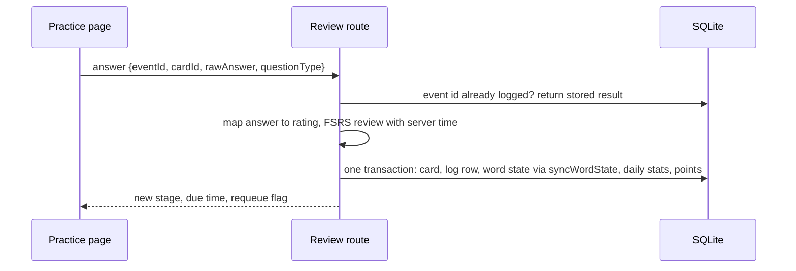
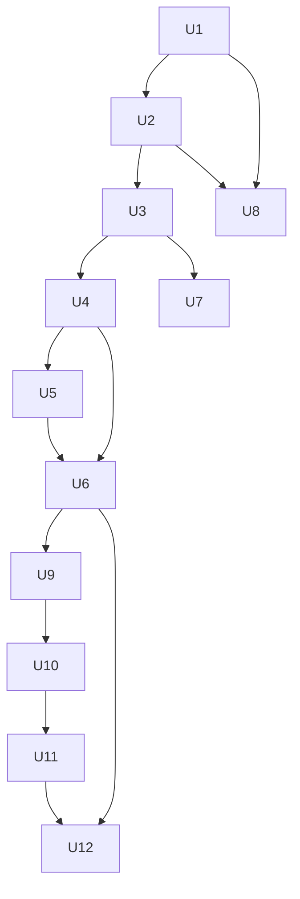

# Word Review Modes - Plan

## Goal Capsule

- **Objective:** A learner who saves a word while reading meets it again in Practice, through several kinds of question, until they know its meaning when they see it. A learner who chooses spelling practice also learns to write it.
- **Means:** Word-level review cards scheduled by FSRS on the server, kept in step with the reader's word state (KTD1, KTD2, KTD4).
- **Product authority:** The Readfox owner, in the brainstorm and planning sessions of 2026-11-04. Sentence bookmarks and sentence comments came up in the same session and are not active scope. On a conflict, the Product Contract's Requirements win on behavior and the Planning Contract's KTDs win on mechanism.
- **Open blockers:** None.
- **Stop conditions:** Stop and ask the owner before a production deploy, before any change to the server's `.env`, and if a migration would need a table rebuild or a drop.
- **Execution profile:** Two stages (R24). Stage 1 is U1–U8 and the Stage 1 part of U12. Stage 2 is U9–U11 and the rest of U12. Each stage ends in a commit on the working branch; push and deploy only on the owner's explicit approval.

---

## Product Contract

**Product Contract preservation:** changed: R15 (stage-to-level mapping made exact), R18 (Tatoeba sentences come from bundled data only), R22 (shared translation also covers non-library sentences and AI sentences), R5 (fallbacks for missing meanings and too few words), R13 (the no-number rule is scoped to Practice, since R25 shows numbers in the reader); added R25–R27, with R27 matching today's practice, where only right answers earn points. All changes were confirmed by the owner in the planning synthesis of 2026-11-04.

### Summary

Every word or phrase a learner saves becomes a review card. The card moves through question types as the learner learns it: choose the meaning, then a recognition card (think, reveal, rate Know / Fuzzy / Don't know), then a fill-in-the-blank on a different real sentence each time, with its source shown. FSRS schedules the reviews, and the card's stage stays in step with the word's highlight in the reader.

### Problem Frame

Learners save words while they read, but outside the guided first lesson a saved word never reaches Practice. Practice draws its cards from the bundled common-word sentence banks and from the single onboarding card. English, one of the two languages open in production, has no bundled bank, so an English learner has almost nothing to practise. A saved word sits on the Words page until the learner forgets it.

Practice also tests only one skill. Every card is one sentence with one blanked word, and the multiple-choice options are words, not meanings. A learner always sees the word in the sentence where they saved it, so they can learn that sentence instead of the word. The longest review gap is 14 days, so a word counts as learned after about a month and then never returns.

### Key Decisions

- **The word is the review unit, and the question type follows the word's stage.** The learner does not pick a mode for each word. Governs R4, R5, R6, R8. (session-settled: user-approved — chosen over a separate "My words" group where the learner picks the question type, and over adding in-reading prompts now: only a stage-driven sequence makes sure every word meets several question types.)
- **Recognition, not spelling, is the default goal; spelling is an opt-in.** Governs R10. (session-settled: user-directed — the owner asked that learners can switch between "recognize" and "spell"; the goal stated in dialogue is knowing a word's meaning on sight.)
- **Three answers on the recognition card: Know, Fuzzy, Don't know.** No 1–4 familiarity scale and no "Easy" answer. Governs R6, R7, R11. (session-settled: user-directed — the owner dropped the 1–4 scale in the opening request.)
- **FSRS schedules every review from the start.** Governs R11, R13, R14. (session-settled: user-approved — chosen over fixed gaps of 1/3/7/14/30/60/120 days: FSRS comes from the same research line as MaiMemo and is what Anki uses, and switching later would mean migrating review history twice.)
- **One familiarity for the word, shared by review and the reader.** Governs R15, R16, R17. (session-settled: user-approved — chosen over syncing only when a word is learned, and over keeping the two separate: the learner sees one state for each word.)
- **Real sentences come from licensed data Readfox already ships; no web crawling and no live calls to third-party sentence sites.** Governs R18, R19, R21. (session-settled: user-approved — chosen over crawling the web and over calling Tatoeba at review time: both bring copyright or privacy-text changes and slow, failure-prone lookups.)
- **Shared sentence translations and AI sentences are made once, used by everyone, and do not count against any allowance.** Governs R22. (session-settled: user-approved — the owner pays this cost so that review does not use up a Free learner's allowance.)
- **All three parts are planned together and ship in two stages.** Governs R24. (session-settled: user-directed — chosen over planning only the recognition card or only the real sentences first.)

The diagram shows the default "Recognize" goal. R4 and R10 carry the full rules.

### Requirements

**Words enter review**

- R1. Every word or phrase a learner saves becomes a review card for that word in the learner's target language, unless the word's reader state is known or ignored.
- R2. Words saved before launch join review gradually: at most 20 new cards a day for each target language. Words saved today come first; older words wait their turn, oldest first.
- R3. A word that the learner deletes from the Words page leaves review.

**Question types and stages**

- R4. A card's question type follows its stage: New asks the learner to choose the meaning; Learning shows the recognition card; Familiar asks a real-sentence fill-in; Mastered shows the recognition card as a spot check.
- R5. Choose-the-meaning shows four meanings, one correct. The wrong ones are meanings of the learner's other saved words in the same language, and no two options read the same. When fewer than three other usable meanings exist, the card shows the recognition card instead. A word with an empty meaning gets one from the dictionary first; with no meaning at all, it is not offered until it has one.
- R6. The recognition card shows the word, and its audio where the language has audio, without the meaning. The learner taps to reveal the meaning and an example sentence, then answers Know, Fuzzy or Don't know.
- R7. After Know, an "I was wrong" control stays available until the next card; it changes the answer to Don't know.
- R8. The real-sentence fill-in blanks the word in a sentence the card did not show at its last review, when another sentence exists. It offers four words, one correct, and shows the sentence's source.
- R9. Phrases get only choose-the-meaning and the recognition card; they skip the fill-in.
- R10. A review-goal setting offers Recognize (the default) or Recognize and spell. With Recognize and spell, the Familiar and Mastered stages also ask the learner to type the word or, where the language has audio, take dictation. Switching goals keeps every card's progress.
- R26. In Chinese and Korean, the fill-in is not offered yet; those cards use the recognition card at the Familiar stage.

**Scheduling**

- R11. FSRS schedules every card. Don't know rates as Again, Fuzzy as Hard and Know as Good. A right answer to a choice, fill-in or typed question rates as Good, and a wrong answer as Again.
- R12. A card answered Don't know, or answered wrong, comes back once more later in the same round.
- R13. In Practice, the learner sees four stages, New, Learning, Familiar and Mastered, and never a number. Mastered cards still return, after long gaps.
- R14. The bundled common-word sentence-bank practice also moves to FSRS, and each card's existing progress carries over.
- R27. Every answered word card counts toward the daily practice streak, and right answers earn points, as in today's practice.

**One familiarity across review and the reader**

- R15. The four review stages match the reader's levels: New is level 1, Learning is level 2, Familiar is level 3, and Mastered is level 4, which the reader shows as known. A Don't know or wrong answer on a Familiar or Mastered card drops it to Learning.
- R16. When a review answer changes a word's stage, the reader's state for the word changes to match, so the next reader page shows the new highlight.
- R17. When the learner marks a word known or ignored in the reader, it leaves review. When the learner sets a word's level in the reader, the card moves to the matching stage.
- R25. When the learner picks a word's level in the reader, one line of small text above the level buttons says what levels 1, 2, 3 and 4 mean.

**Real example sentences**

- R18. A card's sentences come from these sources, in this order: the sentence the learner saved the word from; sentences from the Readfox free library; Tatoeba sentences bundled with Readfox, including the examples in the bundled dictionaries; and, only when none of those has a sentence, an AI-written sentence.
- R19. Every sentence shown carries its source: a book title and chapter that links to the book page, Tatoeba with a link to the sentence, or the label "AI example".
- R20. Shown sentences suit the learner: shorter sentences near the learner's reading level come first.
- R21. Readfox does not crawl the web for sentences.
- R22. Each sentence other than the learner's own is translated into a native language once, and that translation serves every learner with that native language. An AI sentence is written once per word and language and serves every learner. Neither counts against any learner's AI allowance.
- R23. A word with no sentence beyond the learner's own keeps reviewing with that sentence; a missing sentence never blocks a card.

**Rollout**

- R24. Stage 1 ships R1–R7, R9–R17, R25–R27, with the fill-in using only the learner's own sentence. Stage 2 adds R8 and R18–R23.

### Key Flows

- F1. A saved word reaches review
  - **Trigger:** The learner saves "harbor" at level 1 while reading.
  - **Steps:** A card for "harbor" is created at New. The next Practice round asks the learner to choose its meaning from four. On later days it shows the recognition card, then a fill-in on a new sentence from the library.
  - **Outcome:** The reader highlight follows the card's stage the whole way.
  - **Covered by:** R1, R4, R5, R6, R8, R15
- F2. A review round
  - **Trigger:** The learner opens Practice with due cards.
  - **Steps:** Each card asks the question its stage and the review goal call for. The learner answers. Cards answered Don't know or wrong return once before the round ends.
  - **Outcome:** FSRS sets each card's next review; stage changes reach the reader.
  - **Covered by:** R4, R10, R11, R12, R16

### Acceptance Examples

- AE1. **Covers R2.** Given a learner with 300 saved French words and no cards, when review launches, then Practice offers 20 of them as new cards that day, 20 more the next day, and so on.
- AE2. **Covers R6, R7, R11.** Given a recognition card for "fleeting", when the learner taps Know, sees the meaning and realizes it was wrong, and taps "I was wrong", then the answer counts as Don't know and the card returns later in the round.
- AE3. **Covers R11, R13.** Given a Familiar card, when the learner answers Fuzzy, then the card stays Familiar and comes back sooner than after Know.
- AE4. **Covers R15, R16.** Given a Mastered word that shows as known in the reader, when the learner answers Don't know on its spot check, then the card drops to Learning and the word is highlighted again in the reader.
- AE5. **Covers R17.** Given a Learning card for "quay", when the learner marks "quay" known in the reader, then no further review of "quay" appears.
- AE6. **Covers R9.** Given a saved phrase "give up", when it reaches Familiar, then it shows a recognition card instead of a fill-in.
- AE7. **Covers R10.** Given a learner who switches from Recognize to Recognize and spell, when a Familiar card is due, then it can ask for the typed word, and every card keeps its stage.
- AE8. **Covers R8, R19, R23.** Given "harbor" with sentences in two library books, when two fill-ins of "harbor" fall on different days, then they use different sentences, each shows its book and chapter, and a word with no other sentence uses the learner's own sentence.
- AE9. **Covers R18, R19.** Given a rare word with no library or Tatoeba sentence, when it reaches the fill-in stage in Stage 2, then the sentence shown is labelled "AI example".
- AE10. **Covers R2.** Given a learner with 300 waiting old words who saves "quay" today, when they open Practice today, then "quay" is among today's new cards.
- AE11. **Covers R5.** Given a learner whose only saved French words are "chat" and "chien", when "chat" is New, then it shows the recognition card, not choose-the-meaning.
- AE12. **Covers R25.** Given the level buttons for a selected word, then a line above them explains levels 1 to 4 in the interface language.

### Success Criteria

- A saved word meets at least two different question types before it reaches Mastered.
- A learner who saves a word and opens Practice the next day finds that word there.
- The reader and Practice never show different familiarity for the same word.

<!-- ce-section: work-relationships -->
### How This Work Fits Together

This plan covers word review in Practice. The areas below came up in the same brainstorm; they are the current understanding, not a committed roadmap.

- In-reading prompts for saved words ("you saved this word; do you remember it?"): Depends on this plan's cards and stages.
- Sentence bookmarks (save a sentence you like, see it in a list): Can proceed independently of this plan. Still to decide whether bookmarked sentences can also feed review.
- Reader comments on sentences (tap a sentence to read other readers' notes): Can proceed independently of this plan. Needs its own brainstorm on moderation, reporting and privacy text.

### Scope Boundaries

- Deferred: in-reading prompts for saved words, daily review reminders, sentence bookmarks, sentence comments.
- Deferred: tuning FSRS to each learner's own forgetting rate; the review log (KTD6) keeps that open.
- Not in this work: crawling the web or calling Tatoeba at review time (R18, R21), a 1–4 or "Easy" rating, changes to Anki export, and the fill-in for Chinese and Korean (R26).
- Considered and not built: merging a bank card and a word card for the same word. The two keep separate schedules; merge only if learners report seeing a word twice.
- Deferred to follow-up work: store the Tatoeba sentence id in the English dictionary's `examples` table, release a new dictionary asset, and switch KTD14's search links to direct links (needs the owner's release approval).
- Considered and not built: a server-side queue for answers given offline. Practice already needs the network, and a failed review write blocks the next card, as it does today.

### Dependencies / Assumptions

- No usage data exists on how learners review today; the design rests on the owner's goal, not on observed behavior.
- Production opens English and French for learning (`SETUP_READY_LANGUAGES=en,fr`), so those two languages must work first.
- A saved word has one stored meaning, its `translation` text; choose-the-meaning uses it.
- English has bundled dictionary examples (three per word, Chinese translations). French has the bundled sentence bank (about 2,000 words, English translations) and no dictionary examples.

### Outstanding Questions

**Deferred to Planning**

None remain; the Planning Contract resolves each earlier question.

### Sources / Research

- Practice today: `src/app/practice/types.ts`, `src/app/practice/utils.ts` (`calculateNextReview`, `buildMultipleChoiceOptions`), `src/app/practice/persist-review.ts`, `docs/flows/practice.md`.
- Cards and saved words: `api/src/db.ts` (`clozeSentences`, `vocab`, `knownWords`), `api/src/routes/cloze.ts` (seed, onboarding card, `SENTENCE_BANKS` without `en`).
- Reader states and highlight: `src/types/index.ts` (`WordState`), `src/components/MarkdownReader/theme.ts`.
- Sentence sources: `scripts/build-dictionary-en.py` (Tatoeba `examples` with Chinese translations), `api/src/lib/sentence-bank-*.json`, `languages/*/content/library` (212 books).
- Shared AI caches and allowances: `api/src/lib/gloss-cache.ts`, `api/src/lib/entry-cache.ts`, `api/src/routes/translate.ts` (`/localize`), `api/src/lib/entitlements.ts` (`DEFAULT_PLAN_LIMITS`).
- FSRS background: [The history of FSRS for Anki](https://www.lesswrong.com/posts/G7fpGCi8r7nCKXsQk/the-history-of-fsrs-for-anki), [SSP-MMC paper (KDD 2022)](https://scholar.hit.edu.cn/en/publications/a-stochastic-shortest-path-algorithm-for-optimizing-spaced-repeti/), [free-spaced-repetition-scheduler](https://gh.hhj520.top/open-spaced-repetition/free-spaced-repetition-scheduler), [MaiMemo 2025 experiment](https://memodocs.maimemo.com/docs/2025_experiment).

---

## Planning Contract

### Key Technical Decisions

- KTD1. **Scheduling runs on the server with `ts-fsrs` 5.4.2, pinned exactly, FSRS-6 model.** The client sends only an answer; the server computes the next state with server time. 5.4.2 is the last release of the stable API; 6.0.0 was published on 2026-10-28 as a full API rewrite with FSRS-7 as its default, which cannot be converted from FSRS-6 state. Governs R11, R13, R14. Config: desired retention 0.90, maximum interval 365 days, one 10-minute learning step and one 10-minute relearning step, fuzz on in production and off in tests. ts-fsrs is MIT, compatible with AGPL-3.0, and runs on Bun.
- KTD2. **Word cards live in a new table, keyed by user, language and folded word text.** `clozeSentences` has CHECK constraints on `source`, `collection` and `masteryLevel`, and widening them needs a table rebuild, which the beta-safe migration rules forbid. Several vocab rows can fold to one word, and `knownWords` already has one row per folded word, so the folded word is the card's identity; the card keeps a pointer to the newest vocab row for its saved sentence and meaning.
- KTD3. **The stage is derived from FSRS state, never stored as truth.** New: FSRS state New. Learning: Learning or Relearning, or Review with stability under 7 days. Familiar: Review with stability from 7 to under 30 days. Mastered: Review with stability of 30 days or more. Governs R4, R13, R15. A reader level set by hand seeds FSRS state: level 1 resets to New; levels 2, 3 and 4 seed a Review card with stability 2, 10 and 30 days, due now plus that stability. These thresholds are starting values; the review log (KTD6) allows tuning them later.
- KTD4. **One server function owns every word-state change.** It writes `vocab.state`, `knownWords.state` and the word card in one transaction. Every write path calls it: vocab create, update, delete and bulk delete; the known-words bulk upsert; Anki back-sync; backup restore; and review answers. Governs R1, R3, R15, R16, R17. The function takes the source of the change:
  - A reader-sourced change stores the state the learner picked (pressing 4 stores `level4`) and seeds FSRS state per KTD3.
  - A review-sourced change stores the state derived from the stage, so Mastered writes `known` and the card stays active.
  - A hand-marked known or ignored state sets the card's `retiredAt`. An incoming `known` from restore or Anki retires a card only when the card is not already Mastered.
  - Stage derivation treats `level4` and a non-retired `known` both as Mastered.
  This also fixes today's drift, where Practice mastery 100 writes only `knownWords`.
- KTD5. **Cards are created eagerly, introduced lazily.** A card row exists for every eligible saved word from the moment it is saved, plus a one-time idempotent backfill for words saved before launch. The backfill seeds each card from its current reader level per KTD3 (level 1 or `new` stays New), and spreads the due times of seeded Review cards so that no more than 20 per language fall due on one day. A New card becomes part of a round only when the queue introduces it, counted against the daily cap of 20 per language in the learner's time zone (`getTodayDate`). The queue offers New cards saved today first, then older ones oldest first. Governs R1, R2.
- KTD6. **Every answer writes one append-only review-log row.** The row holds the pre-review FSRS state, the rating, the raw answer (dont_know, fuzzy, know, right, wrong), the question type, a client event id (unique, for idempotent retries) and a `wasRequeue` flag. "New cards introduced today" is the count of distinct cards whose first log row falls today. The log makes "I was wrong" an exact undo and keeps a later FSRS-7 move or per-user tuning possible. A per-plan row limit, `maxWordReviewLogRows` (Free 50,000; null on paid plans), bounds the Free takeout. It is enforced by pruning the user's oldest rows inside the answer transaction, never by refusing an answer, and the newest row per card is always kept.
- KTD7. **"I was wrong" is an undo-and-redo of the last answer on that card.** The server restores the card from the log row's pre-review snapshot, marks that row undone, and applies Again as a new row. It is accepted only for the newest row of that card with the same round id. Governs R7.
- KTD16. **The server issues a round id with each queue.** The queue response carries a `roundId` and records the card ids it served. Answers and undo carry the `roundId`. The server accepts answers only for cards served in that round, even when not due, and sets `wasRequeue` itself when the card already has a non-undone row in that round. Governs R12, R27.
- KTD8. **Points and streak move to the server inside the review transaction.** Each answer increments `clozePracticed` once per card per round (not per re-ask), so the mirrored streak helpers stay unchanged. Points: choose-the-meaning 4, recognition Know 3, fill-in 6, typed or dictation 8; a re-ask, Fuzzy or a wrong answer earns 0. Governs R27.
- KTD9. **The review goal is one account setting, `reviewGoal`, with values `recognize` and `recognize_spell`.** It goes into `KNOWN_SETTING_KEYS` and into `PORTABLE_SETTING_KEYS` so a takeout keeps it. The per-language daily cap stays a server constant. Governs R10.
- KTD10. **Bank cards gain nullable FSRS columns on `clozeSentences`, converted lazily.** A bank card whose FSRS fields are empty, or older than its `lastReviewed`, is seeded from its legacy fields when it is next fetched: mastery 0 with no reviews stays New; mastery 25 to 100 becomes Review with stability equal to `nextReview − lastReviewed` in days (minimum 1) and difficulty from the error rate, clamped to 3–8; `nextReview` is kept as the due time. The lazy rule keeps bank cards correct while an older app version on the same database still writes only `masteryLevel`. The existing bank review endpoint keeps its contract for the CLI. Governs R14.
- KTD11. **Sentences are found in memory from shipped files.** The server keeps a lazy per-language index of library sentences and matches a saved word through its inflected forms from the bundled dictionary's `inflections` table. Governs R8, R18, R20, R23.
  - The index stores sentence offsets into per-chapter text, not one object per sentence, and builds in yielded chunks off the request path; a request that arrives before it is ready gets the next source in R18 order.
  - Memory budget: with English and French both built, process RSS grows by under 200 MB (the container limit is 768 MB in `deploy/readfox/docker-compose.yml`).
  - Candidates follow R18 order: the saved sentence, library sentences, bundled Tatoeba sentences (dictionary examples and sentence-bank rows for that word), then an AI sentence. Within a source, rank by sentence length near 6–18 words, then by book level distance from the learner's reading level.
  - A card remembers the last sentence shown and skips it next time, so the saved sentence does not repeat at every review.
- KTD14. **Tatoeba links use the sentence id when the data has one.** Sentence-bank rows carry the Tatoeba id and link to the sentence page. The English dictionary `examples` table has no id today, so those sentences link to Tatoeba's search for the exact sentence text. Governs R19.
- KTD15. **The queue fetch reconciles cards with vocab.** An older app version on the same database writes `vocab` and `knownWords` directly. On each queue request, the server inserts missing cards for eligible vocab rows, removes cards whose folded word has no vocab row, and re-syncs a card from `vocab.state` when `vocab.stateUpdatedAt` is newer than the card's `lastSyncedAt`. Governs R1, R3, R17.
- KTD12. **Shared translations and AI sentences follow the `/localize` pattern.** Two new global tables, with no user id: `shared_sentence_translation` (keyed by language, native language, sentence hash, prompt version) and `shared_example_sentence` (keyed by language, word, prompt version). On a miss, a managed request runs under the same burst limits as `/localize` (30 a minute, 500 a day per user) and never calls `engine.reserve`. A learner with their own key reads shared hits, uses their own key on a miss, and never writes to the shared tables. The learner's own saved sentence never enters a shared table. Governs R22.
- KTD13. **The existing onboarding card is absorbed, not duplicated.** The backfill turns each `onboarding:<vocabId>` mined row into the word card's history: its FSRS state is seeded by KTD10's rule, and the mined row is blacklisted so the bank queue no longer serves it. The guided first lesson keeps its own practice flow on the mined route.

### High-Level Technical Design

**Every word-state write goes through one function (KTD4):**

**Stage and reader level from FSRS state (KTD3, R15):**

Reader levels follow the stage: New = level 1, Learning = level 2, Familiar = level 3, Mastered = level 4 shown as known. Retired cards are not reviewed.

**One review answer (KTD1, KTD6, KTD8):**

**Question type by stage and goal (R4, R9, R10, R26):**

| Stage | Recognize | Recognize and spell | Phrase or zh/ko |
|---|---|---|---|
| New | choose the meaning (recognition if R5 fallback) | same | same |
| Learning | recognition card | recognition card | recognition card |
| Familiar | fill-in, 4 words | typed fill-in | recognition card |
| Mastered | recognition spot check | typed fill-in or dictation, alternating | recognition card |

### Assumptions

- About 48 MB of English and 44 MB of French library text fits in server memory as a lazy per-language index; measured scan times are about 30 ms per word on a warm cache.
- The first request for a language after a deploy pays about 1 s to build the index; this is acceptable for a fill-in that can fall back to the saved sentence while the index builds.
- Shared translation volume is bounded by the sentences learners actually meet, not by the corpus.

### Sequencing

---

## Implementation Units

| U-ID | Title | Key files | Depends on |
|---|---|---|---|
| U1 | FSRS scheduler and stage model | `api/src/lib/review/scheduler.ts`, `api/src/lib/review/stages.ts` | — |
| U2 | Schema and data lifecycle | `api/src/db.ts`, `api/src/lib/adopt-local-data.ts`, `api/src/lib/user-export.ts`, `api/src/routes/data.ts` | U1 |
| U3 | One word-state sync function | `api/src/lib/review/sync-word-state.ts`, `api/src/routes/vocab.ts`, `known-words.ts`, `anki.ts` | U2 |
| U4 | Review queue and answer API | `api/src/routes/review.ts`, `api/src/lib/review/queue.ts` | U3 |
| U5 | Meanings and choices | `api/src/lib/review/meanings.ts` | U4 |
| U6 | Practice word-review round | `src/app/practice/word-review/*`, `src/lib/data-layer.ts` | U4, U5 |
| U7 | Reader level caption and stage display | `src/app/read/[bookId]/page.tsx`, `TranslationDrawer` | U3 |
| U8 | Bank practice on FSRS | `api/src/routes/cloze.ts`, `api/src/lib/review/bank-fsrs.ts` | U1, U2 |
| U9 | Sentence finder | `api/src/lib/review/sentence-index.ts`, `sentence-sources.ts` | U6 |
| U10 | Shared translations and AI sentences | `api/src/lib/sentence-translation-cache.ts`, `api/src/lib/example-sentence-cache.ts` | U9 |
| U11 | Fill-in on real sentences with sources | `src/app/practice/word-review/FillIn.tsx` | U10 |
| U12 | Docs, flows and privacy text | `README.md`, `docs/flows/*`, `messages/src/*/legal.json` | U6, U11 |

### U1. FSRS scheduler and stage model

**Goal:** A tested server module that schedules a card from an answer and derives its stage.

**Requirements:** R11, R13, R15; KTD1, KTD3.

**Dependencies:** None.

**Files:**
- `api/package.json` (add `ts-fsrs` at exactly `5.4.2`), `api/bun.lock`
- Create `api/src/lib/review/scheduler.ts`, `api/src/lib/review/stages.ts`
- Test: `api/src/lib/review/scheduler.test.ts`, `api/src/lib/review/stages.test.ts`

**Approach:**
1. Wrap ts-fsrs behind a small interface: create an empty card, review with a rating at an injected `now`, preview, and seed a Review card from stability and difficulty. Keep ts-fsrs types out of every other module.
2. Map raw answers to ratings per R11 in one table.
3. Derive the stage from FSRS state and stability per KTD3, and map stage to reader state per R15.
4. Map a hand-set reader level to a seeded FSRS state per KTD3.

**Patterns to follow:** pure helpers with injected time, as in `api/src/lib/dates.ts`; constants named like `GLOSS_PROMPT_VERSION` for `FSRS_MODEL` and `FSRS_CONFIG_VERSION`.

**Test scenarios:**
- A new card rated Good becomes Review, due about two days later, stage Learning.
- A new card rated Again becomes Learning, due in 10 minutes.
- Covers AE3. A Familiar card (stability 10) rated Hard stays Familiar and is due sooner than the same card rated Good.
- Covers AE4. A Mastered card (stability 40) rated Again becomes Relearning, stage Learning.
- Stability 6.9 is Learning, 7 is Familiar, 29.9 is Familiar, 30 is Mastered.
- Review-sourced stage to reader state: New → level1, Learning → level2, Familiar → level3, Mastered → known.
- Reader `level4` and a non-retired `known` both derive the Mastered stage.
- Reader level 3 seeds Review with stability 10, due 10 days after `now`.
- No interval exceeds 365 days after repeated Good answers.
- With fuzz off, the same input and `now` give the same output.

**Verification:** The scheduler tests pass with a fixed clock, and no other module imports ts-fsrs.

### U2. Schema and data lifecycle

**Goal:** New tables and columns exist, migrate safely twice, and travel with export, restore, takeout, adoption and account deletion.

**Requirements:** R1, R14; KTD2, KTD6, KTD10, KTD15, KTD16.

**Dependencies:** U1.

**Files:**
- `api/src/db.ts` (new tables in the main `CREATE TABLE IF NOT EXISTS` block; guarded `ALTER` for FSRS columns on `clozeSentences`; indexes)
- `api/src/lib/adopt-local-data.ts` (`TENANT_TABLES`), `api/src/lib/account-deletion.ts` (check it follows)
- `api/src/lib/user-export.ts`, `api/src/routes/data.ts` (restore limits, validation, byte accounting, upserts; restore vocab before cards)
- `api/src/lib/free-takeout-budget.ts`
- Test: `api/src/db.migration.test.ts`, `api/src/lib/adopt-local-data.test.ts`, `api/src/lib/account-deletion.test.ts`, `api/src/routes/data.test.ts`, `api/src/lib/free-takeout-budget.test.ts`

**Approach:**
1. Tenant table `wordCards`: user, language, folded word, card id, newest vocab id, type (word or phrase), FSRS fields (state, due, stability, difficulty, reps, lapses, scheduled days, learning step, last review), `retiredAt`, `introducedAt`, `lastSentenceKey`, `lastSyncedAt` (KTD15), model and config versions, timestamps. Primary key starts with user id; unique on user, language, folded word.
2. Tenant table `wordReviewLog` per KTD6, unique on user and event id, with a `roundId` column (KTD16), append-only apart from KTD6 pruning.
3. Tenant table `reviewRounds` (round id, served card ids, created time), pruned after a day.
4. Nullable FSRS columns plus `fsrsUpdatedAt` on `clozeSentences` (KTD10).
5. Add `maxWordReviewLogRows` to `PlanLimits` and `DEFAULT_PLAN_LIMITS` for every plan (KTD6).
6. Add the tenant tables to export, restore, takeout budget and the tenant list. In `calculateFreeTakeoutUpperBound`, bound `wordCards` by `maxVocabEntries` and the log by `maxWordReviewLogRows`.

**Patterns to follow:** `learner_profiles` and `learner_events` table blocks; `PRAGMA table_info` guards; `shared_gloss_cache` for the global tables.

**Test scenarios:**
- Running migrations twice on a fresh DB and on a synthetic old DB leaves the same schema and no errors.
- An old-version insert into `clozeSentences` without FSRS columns still succeeds.
- The tenant-table ratchet passes with both new tables listed.
- Account deletion removes a user's word cards and review log and leaves another user's rows.
- Export then restore round-trips word cards and log rows; a restore missing these arrays leaves them empty.
- A Free user's full takeout, including review-log rows at the row limit, fits the computed restore envelope.
- An answer at the log row limit succeeds, prunes the oldest row, and keeps the newest row of every card.

**Verification:** API tests for migration, ratchets, export and restore pass; no table rebuild or drop appears in the diff.

### U3. One word-state sync function

**Goal:** Every word-state write keeps `vocab`, `knownWords` and the word card in step.

**Requirements:** R1, R3, R15, R16, R17; F1; KTD4, KTD5, KTD13.

**Dependencies:** U2.

**Files:**
- Create `api/src/lib/review/sync-word-state.ts`, `api/src/lib/review/backfill.ts`
- Modify `api/src/routes/vocab.ts` (create, update, delete, bulk delete), `api/src/routes/known-words.ts`, `api/src/routes/anki.ts` (back-sync), `api/src/routes/data.ts` (restore)
- Test: `api/src/lib/review/sync-word-state.test.ts`, `api/src/routes/vocab.test.ts`, `api/src/routes/known-words.test.ts`, `api/src/routes/anki.test.ts`

**Approach:**
1. One function takes user, language, folded word, the new state, the source of the change (reader, import, Anki, restore, review) and the vocab row when present. It writes `vocab.state` with `stateUpdatedAt`, `knownWords.state`, and the card, inside the caller's transaction.
2. Reader-sourced levels seed FSRS state (U1). Hand-marked known or ignored sets `retiredAt`. A reader level on a retired card clears `retiredAt` and seeds state.
3. Delete removes the card only when no other vocab row folds to the same word, matching the existing `knownWords` rule.
4. Backfill runs once per user and language on first queue request: one card per eligible folded word, seeded and spread per KTD5, `introducedAt` empty for New cards; onboarding mined rows per KTD13. It is idempotent.
5. A reconcile helper (KTD15) brings cards in line with `vocab` rows written outside the function.

**Patterns to follow:** the vocab-plus-knownWords pair in `PUT /api/vocab/:id`; folded-key comparison in app code from the delete path.

**Test scenarios:**
- Saving "harbor" at level 1 creates one New card; saving "Harbor" again does not create a second.
- Covers AE5. Marking "quay" known retires its card; it no longer appears in the queue.
- Setting a word to level 3 in the reader makes its card Familiar (stability 10).
- Deleting one of two vocab rows that fold to the same word keeps the card; deleting the last removes it.
- A known-words bulk import for a word with a card retires the card.
- Anki back-sync that sets a word to level 2 updates the card stage.
- A restore that brings vocab rows creates their cards without duplicates.
- Backfill on 300 words at mixed levels creates New cards for level 1 and Review cards seeded from levels 2–4, with no more than 20 seeded cards due on any one day; a second run creates none.
- Pressing 4 in the reader stores `level4`, gives a Mastered card, and does not retire it.
- A Mastered card's review-written `known` that comes back through restore keeps the card active.
- A vocab row inserted directly (as an older app version does) gets a card on the next queue request; a vocab row deleted directly removes its card; a state changed directly re-syncs the card.
- Backfill turns an onboarding mined card into a seeded word card and blacklists the mined row.
- A word in French and the same spelling in Spanish get two separate cards.

**Verification:** Every route that writes word state goes through the function; a grep for direct `knownWords` writes outside it finds only the function and migrations.

### U4. Review queue and answer API

**Goal:** The server serves a round of due and new word cards and records answers.

**Requirements:** R2, R4, R7, R10, R11, R12, R26, R27; F2; KTD5–KTD9, KTD15, KTD16.

**Dependencies:** U3.

**Files:**
- Create `api/src/routes/review.ts`, `api/src/lib/review/queue.ts`
- Modify `api/src/routes/registry.ts`, `api/src/lib/openapi/annotations.ts`, `api/openapi.json`, `api/src/lib/auth.ts` (`SCOPE_MAP` entry under vocab scopes), `api/src/lib/settings-keys.ts` (`reviewGoal`), `api/src/lib/user-export.ts` (`PORTABLE_SETTING_KEYS`)
- Test: `api/src/routes/review.test.ts`, `api/src/lib/review/queue.test.ts`, `api/src/routes/registry.test.ts`, `api/src/lib/settings-keys.test.ts`

**Approach:**
1. Queue: run the reconcile helper (KTD15), then return due cards (not retired, due now or earlier) plus new cards up to the remaining daily cap per KTD5, each with its stage and question type from the table in the High-Level Technical Design, honoring `reviewGoal` and R9, R26. Issue a round id per KTD16.
2. Due counts for the Practice entry: due now, new available today, and the next due time.
3. Answer: idempotent on event id; checked against the round (KTD16); map answer to rating; schedule (U1); write card, log, word state (U3), daily stats and points (KTD8) in one transaction; return the new stage, due time and whether to re-ask (R12).
4. Undo for "I was wrong" per KTD7.

**Patterns to follow:** `api/src/routes/cloze.ts` due query and language scoping; `reserveDailyStatsRows` and the stats field whitelist in `api/src/routes/stats.ts`; `makeTranslateRoutes` factory style for injecting `now`.

**Test scenarios:**
- Covers AE1. With 300 waiting cards and none introduced today, the queue offers exactly 20 new cards; after those 20 are answered, it offers no more new cards today.
- Covers AE10. A card saved today appears among the new cards ahead of older waiting cards.
- The daily cap resets at local midnight in the learner's time zone (test with Asia/Shanghai).
- An answer sent twice with the same event id writes one log row and returns the same result.
- Covers AE2. Know then undo yields one undone row and one Again row; the card is in Learning and flagged for re-ask.
- Undo on a card whose newest log row is not the one being undone is refused.
- A second answer for the same card in the same round is logged with `wasRequeue`, adds no streak count, and earns no points.
- An answer for a card not served in that round is refused.
- With `reviewGoal` set to `recognize_spell`, a Familiar word asks a typed fill-in; a Familiar phrase still asks a recognition card.
- A Familiar Chinese card asks a recognition card (R26).
- An answer raises `clozePracticed` by one and points per KTD8 in the same transaction; a failed card write writes no stats.
- A token without vocab scope cannot reach the review routes.

**Verification:** The review route tests pass with an injected clock; `api/openapi.json` is regenerated and the registry test passes.

### U5. Meanings and choices

**Goal:** Each choose-the-meaning card arrives with four distinct meanings, or falls back per R5.

**Requirements:** R5; AE11.

**Dependencies:** U4.

**Files:**
- Create `api/src/lib/review/meanings.ts`
- Modify `api/src/lib/review/queue.ts`
- Test: `api/src/lib/review/meanings.test.ts`

**Approach:**
1. Distractors come from the learner's other cards in the same language with a non-empty meaning, compared after `normalize`-style folding so no two options read the same.
2. Fewer than three usable distractors switches the card to the recognition card for this round.
3. An empty meaning is filled from the dictionary entry's first sense in the learner's native language when one exists, through the existing lookup, and saved on the vocab row; otherwise the card is skipped until it has a meaning. This uses no AI.

**Patterns to follow:** `generateDistractors` length-similarity ordering in `src/app/practice/utils.ts`; `lookupWord` in `api/src/lib/dictionary-db.ts`.

**Test scenarios:**
- Four options include the correct meaning exactly once and three distinct others.
- Two saved words whose meanings differ only in case or trailing punctuation are not both offered.
- Covers AE11. With only two saved words, a New card is served as a recognition card.
- A card with an empty meaning gets the dictionary sense and is offered; a card with no dictionary sense is not offered.
- Meanings from another language's cards are never used.

**Verification:** The meanings tests pass; a queue response never carries a choice card with fewer than four options.

### U6. Practice word-review round

**Goal:** Learners review saved words in Practice with the three question types and the review-goal setting.

**Requirements:** R4–R7, R10, R12, R13, R26, R27; F2; AE2, AE6, AE7.

**Dependencies:** U4, U5.

**Files:**
- Create `src/app/practice/word-review/use-word-review-round.ts`, `WordReviewEntry.tsx`, `ChooseMeaning.tsx`, `RecognitionCard.tsx`, `FillIn.tsx`, `TypedFillIn.tsx`, `StageBadge.tsx`
- Modify `src/app/practice/page.tsx` (add the "My words" entry above the existing setup; keep existing labels), `src/lib/data-layer.ts` (queue, answer, undo, counts, `reviewGoal` setting), `src/types/index.ts`
- Modify `messages/src/en/practice.json`, `messages/src/zh-CN/practice.json`, generated `messages/en.json`, `messages/zh-CN.json`
- Test: `src/app/practice/word-review/__tests__/use-word-review-round.test.ts`, `src/lib/data-layer-review.test.ts`, `e2e/word-review.spec.ts`

**Approach:**
1. A separate round hook for word cards reuses the phase idea of `use-cloze-round.ts` (setup, practicing, feedback, complete) and its retry queue, without touching the cloze reducer.
2. Recognition card keys: Space or Enter reveals; 1, 2, 3 answer Don't know, Fuzzy, Know. Keep `isInteractiveKeyTarget` and `isComposing` guards.
3. "I was wrong": after Know, the next card appears at once, and a small text button "I was wrong" sits in the next card's footer (or on the summary after the last card) until that card is answered. It is hidden after any other answer.
4. Choose-the-meaning uses keys 1–4 like the existing MC.
5. In Stage 1 the fill-in uses the learner's saved sentence (R24); dictation reuses the existing dictation component where `hasAudio()` is true.
6. The stage badge is a small muted pill from the `ui/` badge, shown only in the answer feedback; the round summary lists only cards that changed stage.
7. States, using the existing cloze setup's look and no new chrome:
   - No saved words: one sentence pointing to the reader.
   - Nothing due: one muted line with the next due time.
   - Loading: a skeleton inside the existing card.
   - Queue fetch failed: the existing toast with a retry button.
   - Complete: answered count, count to retry, next due time.
   - A failed answer write blocks advancing and shows the existing toast.
8. The review-goal control lives in Settings, with one line of help text per option. The Practice entry shows the current goal as a small text link that opens the same control.

**Patterns to follow:** `src/app/practice/use-cloze-round.ts` and its tests; MC buttons in `page.tsx` (`data-testid="mc-option"`); `src/app/practice/components/Dictation/DictationCard.tsx`; `ui/` components for buttons and cards.

**Test scenarios:**
- Covers F2. A round with three due cards shows each card's question type, and a wrong answer brings that card back once at the end.
- Covers AE2. Know, then "I was wrong", shows the card again later in the round and the summary counts it as Don't know.
- Covers AE6. A Familiar phrase shows a recognition card.
- Covers AE7. Switching the goal to Recognize and spell makes the next Familiar word ask for the typed word; stage badges stay the same.
- Keyboard: Space reveals; 3 answers Know; typing inside an input does not trigger shortcuts; an IME composition does not submit.
- A failed answer write keeps the card on screen and shows the error toast.
- With no saved words, the entry shows the pointer to the reader; with nothing due, it shows the next due time.
- "I was wrong" appears on the next card only after Know, and disappears once that card is answered.
- The existing cloze setup labels ("Start", "Top 500", "Type", "MC") are unchanged, so `e2e/practice.spec.ts` still passes.
- e2e: save a word in the reader, open Practice, answer choose-the-meaning, then see the word's stage change.

**Verification:** Unit tests and `e2e/word-review.spec.ts` pass; existing practice e2e specs pass unchanged; both locales have every new key.

### U7. Reader level caption and stage display

**Goal:** The reader explains what levels 1–4 mean and shows review-driven state changes.

**Requirements:** R16, R25; AE4, AE12.

**Dependencies:** U3.

**Files:**
- Modify the level-button area of the word drawer (`src/components/TranslationDrawer/` component that renders the 1–4 buttons) and `src/app/read/[bookId]/page.tsx` if the known-words map needs a refresh on focus
- Modify `messages/src/en/reader.json` (or the namespace that holds the level buttons), `messages/src/zh-CN/` equivalent, generated catalogs
- Test: the drawer's component test, `e2e/reader-word-handling.spec.ts`

**Approach:**
1. Add one line of small, muted text above the level buttons: 1 New, 2 Learning, 3 Familiar, 4 Mastered, using the same stage names as Practice.
2. Reload the known-words map when the reader page regains focus, so a stage change made in Practice shows without a full reload.
3. The reader shows no other stage display; the highlight carries the stage.

**Patterns to follow:** existing muted helper text in the drawer; `getKnownWordsMap` caching in `src/lib/data-layer.ts`.

**Test scenarios:**
- Covers AE12. The level buttons show the caption in English and in Chinese.
- Covers AE4. After a Mastered word gets Don't know in Practice, returning to the reader tab shows it highlighted at level 2.

**Verification:** The caption renders in both locales; the reader e2e spec passes.

### U8. Bank practice on FSRS

**Goal:** The common-word sentence-bank practice schedules with FSRS and keeps each card's progress.

**Requirements:** R14; KTD10.

**Dependencies:** U1, U2.

**Files:**
- Create `api/src/lib/review/bank-fsrs.ts`
- Modify `api/src/routes/cloze.ts` (due fetch seeds FSRS lazily; a new rating-based review path; the old client-computed path stays for the CLI), `src/app/practice/persist-review.ts`, `src/app/practice/use-cloze-round.ts`, `src/lib/data-layer.ts`
- Test: `api/src/lib/review/bank-fsrs.test.ts`, `api/src/routes/cloze.test.ts`, `src/app/practice/__tests__/persist-review.test.ts`, `src/app/practice/__tests__/use-cloze-round.test.ts`

**Approach:**
1. Seed a bank card's FSRS state from legacy fields per KTD10 when its FSRS fields are empty or older than `lastReviewed`.
2. The Practice page sends right or wrong; the server schedules and still writes `masteryLevel` (New 0, Learning 25, Familiar 75, Mastered 100) and `nextReview`, so an older app version reads sensible values.
3. Mastery 100 no longer writes `knownWords` directly from the client; the server sync function (U3) handles known state for bank words the learner has saved.

**Patterns to follow:** existing `POST /api/cloze/:id/review` validation; the lazy seed in `GET /api/cloze/due`.

**Test scenarios:**
- A bank card with mastery 50, last reviewed 3 days before `nextReview`, seeds as Review with stability 3 and keeps its due time.
- A bank card with mastery 0 and no reviews stays New.
- A card whose `lastReviewed` is newer than `fsrsUpdatedAt` (written by an older app version) is re-seeded on the next fetch.
- A right answer writes FSRS fields, `masteryLevel` and `nextReview` together; a Familiar card writes `masteryLevel` 75.
- The CLI's old review request still succeeds.

**Verification:** Cloze route and practice unit tests pass; existing practice e2e specs pass.

### U9. Sentence finder

**Goal:** The server finds real sentences for a word from shipped data, ranked for the learner, rotating between reviews.

**Requirements:** R8, R18, R20, R21, R23; KTD11.

**Dependencies:** U6.

**Files:**
- Create `api/src/lib/review/sentence-index.ts`, `api/src/lib/review/sentence-sources.ts`
- Modify `api/src/lib/review/queue.ts`
- Test: `api/src/lib/review/sentence-index.test.ts`, `api/src/lib/review/sentence-sources.test.ts` (with `LIBRARY_CONTENT_ROOT` fixtures)

**Approach:**
1. Build a per-language index of library sentences on first use, per KTD11: strip markdown, split with `splitSentences`, and store offsets with book slug, lesson, chapter title, level and word count.
2. Expand a saved word to its surface forms through the dictionary `inflections` table; match whole tokens; for phrases, match consecutive tokens without inflection.
3. Collect candidates in KTD11 order, rank within a source, and skip the card's `lastSentenceKey`.
4. For Chinese and Korean, skip the finder (R26).

**Patterns to follow:** `api/src/lib/library-content.ts`; `languages/tokenizer` (`splitSentences`, `tokenizeWords`); `lookupWord` inflection handling in `api/src/lib/dictionary-db.ts`.

**Test scenarios:**
- "harbor" finds "harbors" and "harbored" sentences in the fixture library; "harbinger" does not match.
- Covers AE8. Two consecutive fetches for the same card return different library sentences when two exist.
- After the saved sentence was shown last time, a word with no library sentence gets a bundled Tatoeba sentence; with none of those, the saved sentence again.
- A request that arrives while the index is still building gets the next source without waiting.
- Sentences over 30 words rank below shorter ones; with equal length, a book at the learner's level ranks first.
- The phrase "give up" matches a sentence containing "give up" and does not match "gave up" (phrases match exact tokens only).
- The index builds once per language per process.

**Verification:** Finder tests pass against fixtures; a check on the shipped libraries stays under 2 s cold and 50 ms warm per lookup, and RSS growth with English and French built stays under 200 MB.

### U10. Shared translations and AI sentences

**Goal:** Non-learner sentences arrive in the learner's native language, and rare words get one shared AI sentence, without touching allowances.

**Requirements:** R18, R19, R22; KTD12.

**Dependencies:** U9.

**Files:**
- `api/src/db.ts` (global tables `shared_sentence_translation` and `shared_example_sentence`, outside `TENANT_TABLES`)
- Create `api/src/lib/sentence-translation-cache.ts`, `api/src/lib/example-sentence-cache.ts`
- Modify `api/src/lib/llm/types.ts` (tasks `sentence-translation`, `example-sentence`), `api/src/lib/llm/index.ts`, `api/src/lib/translate-prompts.ts`, `api/src/lib/review/sentence-sources.ts`
- Test: `api/src/lib/sentence-translation-cache.test.ts`, `api/src/lib/example-sentence-cache.test.ts`, `api/src/lib/translate-prompts.test.ts`, `api/src/routes/review.test.ts`

**Approach:**
1. Translation: use a bundled translation when its language is the learner's native language; else read the shared cache; else run a managed request under the `/localize` burst limits and store it.
2. AI sentence: only when R18's earlier sources are empty; read the shared cache by language and word; else generate one short sentence at a neutral level with its translation, validate that it contains the word, and store it.
3. BYOK per KTD12. A failed or rate-limited request returns no sentence, and the card falls back to the saved sentence (R23).
4. Prompts carry version constants for cache invalidation.

**Patterns to follow:** `/localize` in `api/src/routes/translate.ts`; `api/src/lib/gloss-cache.ts`; `rate-limit.ts`; `api/src/scripts/warm-entry-cache.ts` for an optional offline warm run later.

**Test scenarios:**
- A cache hit costs no provider call and no allowance.
- A miss for a Free managed user calls the provider once, stores the result, and never reserves an allowance metric.
- A BYOK user's miss uses their provider and writes nothing to the shared table.
- The learner's own saved sentence is never sent to the shared table.
- An AI sentence that does not contain the target word is rejected and not stored.
- Burst limit reached: no sentence returned, card falls back to the saved sentence.
- A bundled Chinese translation for an English dictionary example is used directly for a zh-CN learner.

**Verification:** Cache and route tests pass with an injected provider; no `engine.reserve` call appears in these paths.

### U11. Fill-in on real sentences with sources

**Goal:** The fill-in shows rotating real sentences with their source.

**Requirements:** R8, R19; AE8, AE9.

**Dependencies:** U10.

**Files:**
- Modify `src/app/practice/word-review/FillIn.tsx`, `src/app/practice/word-review/RecognitionCard.tsx` (example sentence on reveal), `src/lib/data-layer.ts`
- Modify `messages/src/en/practice.json`, `messages/src/zh-CN/practice.json`, generated catalogs
- Test: `src/app/practice/word-review/__tests__/fill-in.test.ts`, `e2e/word-review.spec.ts`

**Approach:**
1. Render the sentence with the blank at the matched token, four word options built from the learner's other words of similar length, and the source line below.
2. Library sources name the book in the interface language and the chapter, linking to `/books/<language>/<slug>`; Tatoeba sources link per KTD14; AI sentences show "AI example".
3. The translation toggle follows the existing `Alt+T` behavior.

**Patterns to follow:** `createBlankedSentence` and `splitTrailingPunctuation`; `pickLocalized` for book titles; existing feedback translation display.

**Test scenarios:**
- Covers AE8. A library sentence shows the book title and chapter and links to its book page.
- Covers AE9. An AI sentence shows the "AI example" label.
- A sentence-bank row links to its Tatoeba sentence page; an English dictionary example links to Tatoeba's search for its text.
- Trailing punctuation stays outside the blank.
- Choosing the right word marks it correct and shows the full sentence with its translation.

**Verification:** Unit tests and the e2e journey pass; all labels exist in both locales.

### U12. Docs, flows and privacy text

**Goal:** Public and contributor docs describe the new review, and the privacy text matches what is stored.

**Requirements:** R21, R22.

**Dependencies:** U6 for the Stage 1 part, U11 for the Stage 2 part.

**Files:**
- `README.md` (Practice section), `docs/flows/practice.md`, `docs/flows/vocabulary.md`, `docs/flows/graph-data.js` (new tables and routes), `docs/readfox-handoff.md`, `AGENTS.md` (word-state sync rule)
- `messages/src/en/legal.json`, `messages/src/zh-CN/legal.json`, generated catalogs (review history is stored with the account and exported; shared sentence translations hold no user data)
- The owner's `readfox-todo.md`, one level above the repo; update it in the same session

**Approach:** Stage 1 docs land with U6; the Stage 2 sentence-source and shared-translation text lands with U11. Run the flow-graph validator after editing the graph.

**Test expectation:** none -- documentation and privacy text; `src/i18n/messages.test.ts` and the flow validator cover catalog and graph drift.

**Verification:** The flow validator and i18n catalog test pass; the privacy page names the review history and the shared translations.

---

## Verification Contract

- Frontend type check, unit tests and lint on changed files: `npm run check`; full unit suite: `npx vitest run`.
- API tests: `cd api && bun run test` (never bare `bun test`); one file: `cd api && DATA_DIR=.test-data bun test <path>`. The full suite takes 13–18 minutes; do not run it beside vitest or a dev server.
- OpenAPI: `npm run gen:openapi` after route changes; the registry test fails if stale.
- i18n: `node scripts/merge-messages.mjs`; `src/i18n/messages.test.ts` must pass.
- Flow graph: `node docs/flows/validate-graph.mjs`.
- E2E: `npx playwright test e2e/word-review.spec.ts e2e/practice.spec.ts e2e/mc-fallback.spec.ts e2e/dictation.spec.ts e2e/reader-word-handling.spec.ts e2e/data-takeout.spec.ts e2e/onboarding.spec.ts`. Six onboarding, free-books and free-tier tests already failed on f41644e before this work; a change is a regression only if a test that passed before now fails.
- Production build: `npm run build` before any push.
- Format: `npx prettier --write <touched files>`, then `npx prettier --check` and `git diff --check`.

## Definition of Done

- Every unit's verification holds, and every AE has a passing test that names it.
- A saved English or French word reaches Practice the next day and moves through at least two question types before Mastered, shown by the e2e journey.
- No migration rebuilds or drops a table; migrations run twice cleanly.
- No word-state write bypasses the sync function.
- Both locales carry every new string; the privacy text, README and flow maps are current.
- Abandoned-attempt code and temporary debug output are removed from the diff.
- Stage 1 and Stage 2 each end in a local commit; nothing is pushed or deployed without the owner's explicit approval.
