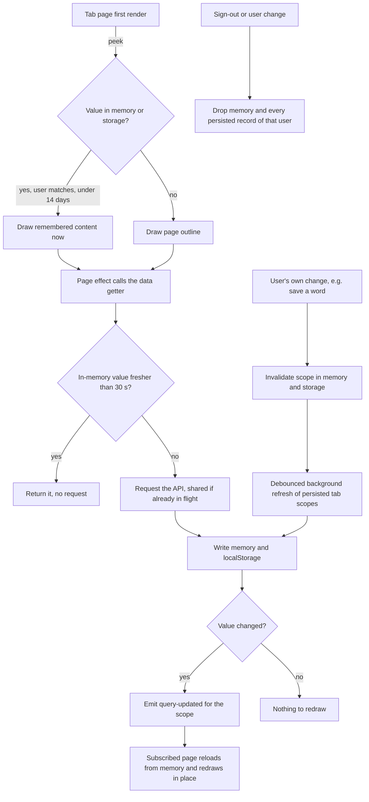
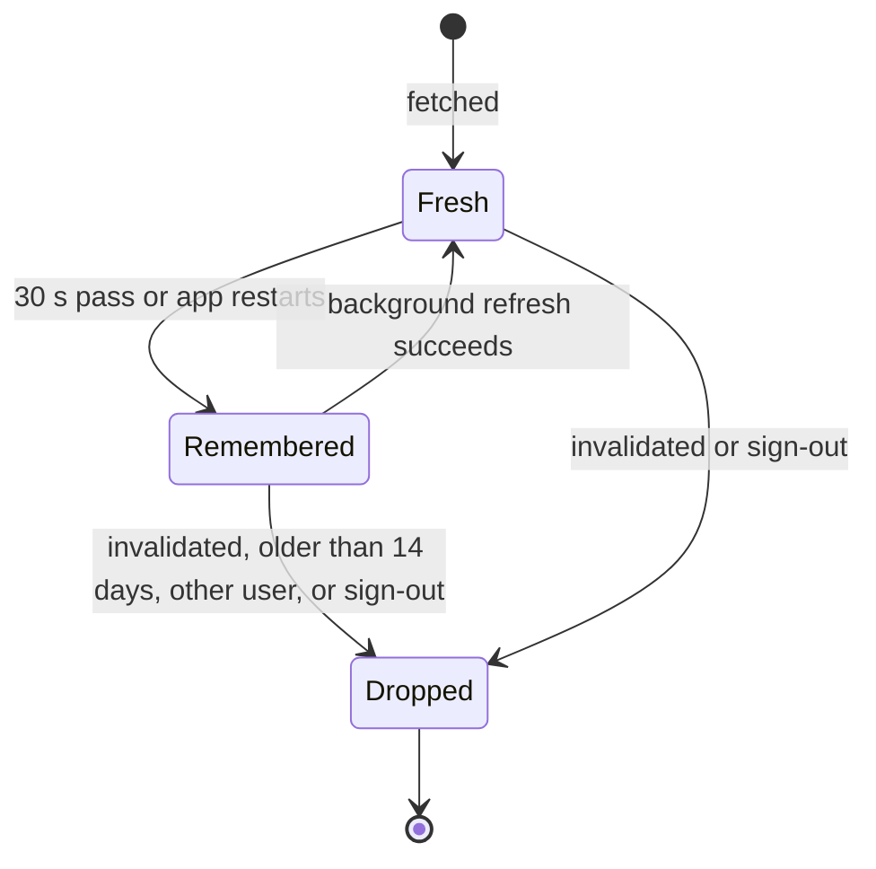
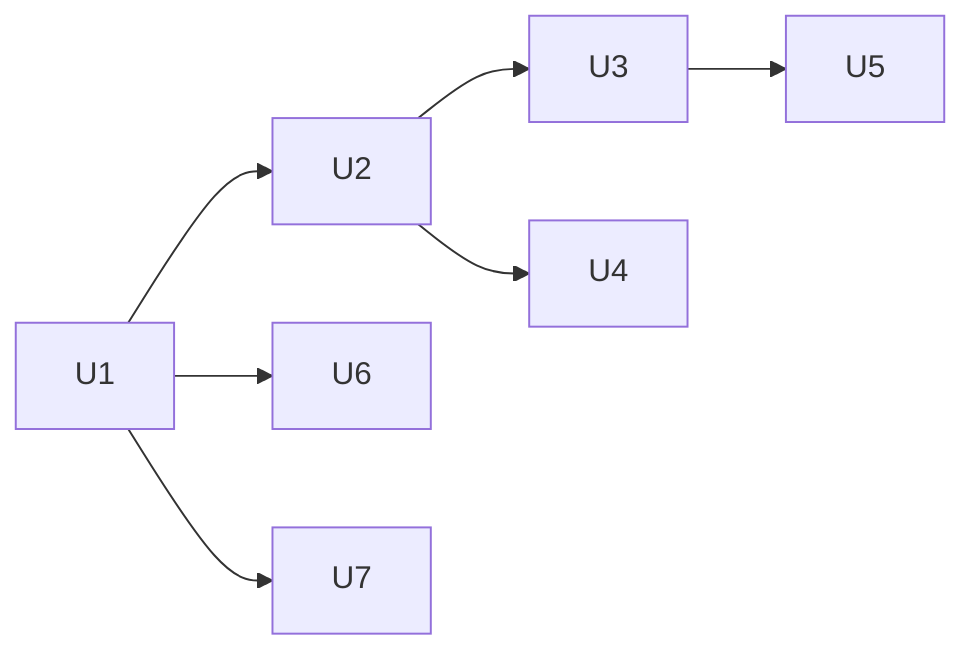

# Instant Tab Switching and Book Opening - Plan

## Goal Capsule

- **Objective:** In the iPhone app, switching bottom tabs and reopening a recently read book show content with no visible wait, even when the phone is far from the server (China, through a VPN). This plan covers speed only. The library page layout redesign is not active scope.
- **Means:** Show the content each tab or recent book had last time at once, refresh it in the background, preload the other tabs after launch, and keep each tab's scroll position.
- **Product authority:** The owner chose the scope, the stale-first behavior and the approach in the 2026-11-11 brainstorm. The Product Contract wins on behavior; the Key Technical Decisions win on mechanism.
- **Open blockers:** None.
- **Stop conditions:** Stop and ask if a unit would need a new npm dependency, a change to the API server, or a change to the `offline.json` format shared with the iOS launcher.
- **Execution profile:** Web front end (`src/`), its tests (`e2e/`), message catalogs (`messages/`) and flow docs (`docs/flows/`), shipped by the normal deploy. No App Store build is needed, because the app loads the live site.

---

## Product Contract

Product Contract preservation: Product Contract unchanged.

### Summary

Every tab and every recently opened book draws its last known content the moment it is tapped, then updates quietly. After launch, the app fetches the other tabs in the background, so the first tap on each is instant too. Switching back to a tab returns to the same scroll position.

### Problem Frame

The owner tested the app on 2026-11-11 on 5G in mainland China, with a VPN on. Each tab switch and each book opening showed a spinner for 1 to 3 seconds, so the app felt like a slow website, not an iPhone app.

The server is not the cause. On the server itself, the library, books and home pages take 0.02 to 0.04 s, and CPU and memory are mostly idle. One request from the owner's network takes 1.4 to 1.9 s, mostly connection setup across the Pacific. A tab page makes several requests when it opens: the library makes 3, and statistics makes about 9 in three waves. So each tap costs several long round trips before anything shows.

The app already has a small shared in-memory cache, but it does not remove the wait. It lives for 30 s, disappears when the app restarts, and does not cover every request a page makes. The reader always loads the lesson from the server, although the app already keeps the five most recent lessons on the phone for offline reading.

### Key Decisions

- **Speed before layout.** The library redesign (WeChat Read style) is a separate, later plan. A redesigned page would still feel slow without this work. (session-settled: user-approved — chosen over doing the library layout first: speed helps every page, and a new layout would still feel slow)
- **Show old content first, then refresh.** For a moment the user may see old numbers or a book list without a book just added elsewhere. Governs R1, R2, R4. (session-settled: user-approved — chosen over showing old content only for book lists, and over always waiting for fresh data with a skeleton: instant tabs matter more than a one-second lag in numbers)
- **Remembered content, preloading and kept scroll position; no other speed-ups in this plan.** Governs R1–R7. (session-settled: user-approved — chosen over adding one request per page, over keeping tabs alive in memory only, and over moving the screens into the app: this covers both slow taps the owner named with the least added scope)
- **Extend the existing shared cache; do not add a second one.** The shared in-memory cache already de-duplicates requests, so the work grows it into a cache that survives restarts and covers every tab request.
- **Practice never starts a review from old cards.** Old content is acceptable to look at, not to answer. Governs R4.
- **Same behavior on the website.** The web pages share this code, and web users far from the server get the same gain. Governs R8.

### Requirements

**Tabs**

- R1. When the user opens a bottom tab (Library, Practice, Journal, Vocab, Statistics) they have seen before on this device, the tab shows its last content at once, with no spinner, and then updates in place when fresh data arrives.
- R2. The remembered content survives closing and reopening the app.
- R3. After the app opens and the user is signed in, it fetches the data for the tabs not yet visited in the background, so the first visit to each shows content at once.
- R4. Practice may show its remembered summary at once, but a review session starts only with fresh cards from the server.
- R5. When the user switches back to a tab, it shows the same scroll position it had when they left.
- R6. A tab with nothing remembered yet (first use, or right after sign-in before preloading finishes) shows an outline of the page in place of a blank spinner.

**Books**

- R7. Opening one of the recently read lessons already kept on the phone shows its text at once from that copy, then checks for changes in the background. A book not kept on the phone shows its title and a page outline at once while the text loads.

**Privacy and scope**

- R8. The same behavior applies on the website, which shares this code.
- R9. Signing out, or reaching the sign-in page signed out, removes all remembered content from the device.
- R10. The privacy page states what is kept on the device and when it is removed, updated in the same change.

### Acceptance Examples

- AE1. **Covers R1, R2.** **Given** the user opened Statistics yesterday, **when** they open the app today and tap Statistics, **then** yesterday's numbers show at once and change to today's within a few seconds.
- AE2. **Covers R3, R6.** **Given** the user just signed in on a new phone, **when** they tap Vocab before preloading finishes, **then** they see the page outline, not a spinner. **When** they tap Journal ten seconds later, **then** its content shows at once.
- AE3. **Covers R4.** **Given** the user reviewed all due cards on the website, **when** they open Practice in the app, **then** the old due count may show for a moment, and pressing start never shows those already-reviewed cards.
- AE4. **Covers R5.** **Given** the user scrolled halfway down the library, **when** they go to Vocab and back to Library, **then** the library is at the same place.
- AE5. **Covers R7.** **Given** the user read a lesson yesterday, **when** they tap that book today, **then** its text shows at once. **Given** a book they never opened, **then** its title and a page outline show at once, and the text follows.
- AE6. **Covers R9.** **Given** a user signs out on a shared phone, **when** a second person signs in, **then** none of the first user's books, words or numbers ever show.

### Success Criteria

- On the owner's phone in mainland China with a VPN on, revisiting any tab and reopening a recently read book show content with no visible wait.
- No tab or book ever shows a blank screen with only a spinner.

### Scope Boundaries

- The library page layout redesign (shorter header, compact book cards like WeChat Read): the next plan.
- One combined request per page: deferred. Revisit if first visits are still slow after this work.
- A relay server nearer China: not part of this. The owner decided against buying one on 2026-10-16, and with a VPN on it would not help.
- Moving the screens into the app bundle: deferred. Largest gain, but every UI change would then need an App Store release.
- Word lookup speed and app launch time: not named by the owner as slow, so not in scope.

<!-- ce-section: work-relationships -->
### How This Work Fits Together

This plan covers only the speed of tab switching and book opening. The breakdown below is the current understanding, not a committed roadmap.

- Library page layout redesign, following UI/UX Pro Max and WeChat Read: can proceed independently of this plan. It shares the library page, so whichever lands second rebases onto the first.
- One combined request per page: depends on this plan's results. Still to decide whether it is needed.

### Dependencies / Assumptions

- Data comes from the same account on several devices (website and app), so remembered content can be out of date. R4 and AE3 cover the case where that matters.
- A one-to-two-second lag in numbers is acceptable everywhere except starting a review. The owner accepted this.

### Sources / Research

- `src/lib/query-cache.ts`: the existing shared in-memory cache (30 s life, shared in-flight requests).
- `src/lib/data-layer.ts`: which calls use the cache and which do not (groups, settings, collection counts, lessons).
- `src/app/(index)/page.tsx` and `src/app/stats/page.tsx`: the requests each tab makes when it opens.
- `src/lib/offline/store.ts`: the five most recent lessons kept on the phone. `src/app/read/[bookId]/page.tsx` saves to it but never reads from it.
- `src/components/NativeBridge/NativeTabBarSync.tsx`: tab switches use client-side navigation, so pages remount on each switch.
- `src/app/(auth)/login/page.tsx`: reaching sign-in signed out already clears the offline lessons.
- Measurements on 2026-11-11: 0.02–0.04 s on the server; 1.4–1.9 s per request from the owner's network; 456 KB of compressed JavaScript for the library page on first load, cached afterwards.

---

## Planning Contract

### Key Technical Decisions

- KTD1. **Grow `src/lib/query-cache.ts` into a stale-while-revalidate cache that also persists.** A remembered value is returned at once and refreshed in the background. Pages also get a synchronous peek for their first render. The in-memory layer keeps its 30 s freshness window, its de-duplication of in-flight requests and its invalidation rules. Governs R1, R2. (session-settled: user-approved — chosen over showing old content only for book lists and over always waiting for fresh data: instant tabs matter more than a one-second lag in numbers)
- KTD2. **Persist in `localStorage`, one record per cache key, in both the app and the website.** `localStorage` is synchronous, so pages can draw remembered content on their first render without a hydration step. WKWebView supports it on the live origin, and the website gets the same behavior (R8) with no second adapter. Capacitor Filesystem was rejected: it is async, app-only, and its helpers no-op on the web. IndexedDB was rejected: it is async and would need a hydration gate before first paint. A failed or full write leaves the value in memory only and never fails the page.
- KTD3. **Every persisted record carries its user id and save time; only sign-out wipes storage.** `clearQueryCache` and `clearTenantQueries` stay memory-only, because `setActiveTenant` calls `clearQueryCache` on every cloud launch (user id goes from null to known) and `writeLanguageCache` calls `clearTenantQueries` on a language switch. Wiping storage there would empty it at every start and break R2. `setActiveTenant` removes only records of a different user. `invalidateQueries` removes the matching persisted records. A new storage wipe runs only from the sign-out helper and the login-page fallback (KTD10). Records older than 14 days are not shown. Governs R2, R9.
- KTD4. **Invalidation after a user's own change refreshes only the invalidated keys, later and quietly.** Removing the stale record keeps pre-edit content from showing. The refresh then runs only for invalidated keys whose loader was registered this session, as a trailing debounce of at least 5 s, and waits while the route is `/read/*` or the page is hidden. The reader calls `incrementDailyStat` on every lookup, so an eager refresh would re-download all vocab and all daily stats on the slow link during reading. Keys with no registered loader are only removed. Governs R1.
- KTD5. **Only summary requests join the persisted cache. Review sessions stay uncached.** `getReviewQueue`, `getClozeSentencesByCollection` and `getNewSentencesByCollection` never read the cache, so a review always starts from fresh cards. Governs R4.
- KTD6. **Values that JSON cannot carry are cached as raw API data and mapped on read.** JSON turns `Date` objects into strings and a `Map` into `{}`. `getAllVocab` and the vocab getters map dates outside the cached loader, and `getKnownWordsMap` caches the raw object and builds a new `Map` on each read, as `getLessonReadings` already does.
- KTD7. **Save and restore window scroll per tab by hand. Do not turn on Next's Cache Components/Activity.** Activity keeps at most 3 routes alive and the app has 5 tabs. Enabling `cacheComponents` is a migration that can break the build, and the docs do not say whether window scroll survives. Tab navigation passes `scroll: false`, and each tab page restores its saved offset once its content has drawn. Governs R5. (session-settled: user-approved — chosen over keeping tabs alive in memory only: keeping scroll position was the part of that approach the owner kept)
- KTD8. **Recent lessons use the same persisted cache, capped at the 5 most recently opened, and the reader reads only from it.** `offline.json` keeps its current role unchanged: the reader writes it through `rememberLesson`, and only the bundled iOS launcher reads it offline (`ios-app/launcher/offline-reader.js`). Its record holds only text and title, so it cannot serve the online reader. Governs R7.
- KTD9. **Preloading warms the cache, not the pages.** After the signed-in user is known, and once the browser is idle, the app calls the data getters of tabs not yet visited and prefetches their routes. It runs once per user per session, on the website too. Governs R3, R8.
- KTD10. **One shared sign-out helper wipes device data.** It clears the query cache (memory and storage) and the offline lessons. Every sign-out path calls it: the account menu, the subscribe page and the billing guard. Account deletion does not sign out at request time, because better-auth's emailed `/delete-user/callback` needs the session. Deletion ends on `/login?deleted=1`, where the login-page wipe runs. Governs R9.
- KTD11. **A loader joins the persisted cache only if it rejects on a failed response.** `apiFetch` never throws: a network error comes back as a synthetic JSON 502, and many getters resolve that as a value (`{error: …}` or `undefined`). Each persisted getter rejects on any non-ok status, and maps a real 404 to its not-found value. A failed background refresh then keeps the remembered value instead of storing the error. Governs R1, R2, R7.

### High-Level Technical Design

The flow below shows how one tab read moves through the cache.

A persisted record goes through these states:

### Assumptions

- A book reached by a deep link (an email or notification) before the library list was ever remembered shows the outline without a title until the lesson loads. Every book opened from the library has its title in the remembered collections list.
- Remembered data fits comfortably in `localStorage` (about 5 MB per origin). The largest payloads are all vocab and all daily stats: about 200 KB for 1,000 words today. Records above a size cap are kept in memory only.
- iOS may clear website storage under pressure. Then the user sees the outline once, which R6 already covers.
- Serving a stale summary next to a fresh review queue is acceptable, as AE3 states.

### Sequencing

U1 and U2 come first. After them, U3, U4, U6 and U7 can land in any order. U5 lands after U3, because it restores scroll only once U3's pages report that their content has drawn.

---

## Implementation Units

### U1. Persisted stale-while-revalidate in the shared cache

**Goal:** The shared cache returns a remembered value at once, refreshes it in the background, and keeps values across app restarts per user.

**Requirements:** R1, R2, R9. KTD1, KTD2, KTD3, KTD4, KTD11.

**Dependencies:** None.

**Files:**
- `src/lib/query-cache.ts` (modify)
- `src/lib/query-cache-store.ts` (new: `localStorage` records, user tag, save time, size cap, quota handling)
- `src/lib/language-cache.ts` (modify: on user change, drop other users' persisted records)
- `src/lib/query-cache.test.ts` (extend)
- `src/lib/query-cache-store.test.ts` (new)

**Approach:**
1. Add an opt-in persisted mode per call, plus a synchronous peek that returns a remembered value or nothing.
2. When the in-memory entry is older than 30 s but a remembered value exists, resolve with the remembered value and start one background refresh. A caller that needs fresh data can still force a wait.
3. After a refresh, write memory and storage. Emit a `query-updated` event with scope and user only when the serialized value changed.
4. Make invalidation remove persisted records, and a user change remove only other users' records (KTD3). Add a storage wipe for the sign-out helper (KTD10).
5. Register each persisted key's loader for the session, and add the deferred refresh of invalidated keys (KTD4).
6. Keep the existing contracts: a `null` key bypasses everything, a failed request is never cached, and an invalidation during a request stops that request from writing back.

**Patterns to follow:** existing key scheme and tests in `src/lib/query-cache.test.ts` (fake timers, `clearQueryCache` in `beforeEach`). The user-tag pattern is `forgetOtherUsers` in `src/lib/offline/store.ts`.

**Test scenarios:**
- A persisted value from a previous session is returned by peek and by the getter immediately, and one background request follows.
- A value fresher than 30 s in memory causes no request.
- A refresh that returns an identical value emits no `query-updated` event. A changed value emits exactly one.
- Two callers during one refresh share a single request.
- A record saved by user A is not returned to user B. Switching the active user to B removes A's records from storage.
- A cloud launch (active user goes from none to A) keeps A's records, and a peek right after returns them (Covers AE1).
- `clearQueryCache` and `clearTenantQueries` empty memory but leave storage. The sign-out wipe empties storage.
- A record older than 14 days is ignored and removed.
- `invalidateQueries` for a scope removes its persisted records. Ten invalidations within 5 s cause one request per invalidated key with a registered loader, and none for other scopes.
- The deferred refresh does not run while the route is `/read/*` or the page is hidden, and runs after leaving the reader.
- A storage write that throws (quota) leaves the value usable from memory and no exception reaches the caller.
- A value above the size cap is not written to storage.
- An invalidation during a pending refresh stops that refresh from writing memory or storage.
- A failed refresh keeps the remembered value and does not overwrite it. A loader that rejects on a synthetic 502 leaves memory and storage unchanged and emits no event (KTD11).

**Verification:** The unit tests pass, and the existing query-cache tests pass unchanged.

### U2. Route every tab request through the cache

**Goal:** Every request a tab page makes when it opens can be answered from the persisted cache. Review sessions stay uncached.

**Requirements:** R1, R3, R4. KTD4, KTD5, KTD6, KTD11.

**Dependencies:** U1.

**Files:**
- `src/lib/data-layer.ts` (modify)
- `src/lib/onboarding.ts` (modify)
- `src/lib/data-layer-tab-cache.test.ts` (new)
- `src/lib/data-layer-vocab.test.ts` (extend for raw-row caching and date mapping)

**Approach:**
1. Put the tab getters on the persisted mode: collections, groups, collection counts, journal entries, vocab, review counts, cloze totals, streak, daily/fluency/reading stats, app-wide activity, `getSetting` per key, the reading feed (`getReadingFeed`), and the onboarding snapshot. Each one rejects on a non-ok response first (KTD11).
2. Add invalidation where mutations had none, because these getters were uncached: group create/update/delete, journal create/update/delete, `setSetting`/`deleteSetting` (that key), review answers (review counts), cloze progress and `seedSentenceBank` when it adds sentences (counts and totals).
3. Cache vocab as raw rows and map dates on read (KTD6).
4. Leave `getReviewQueue` and the cloze sentence getters untouched (KTD5).

**Patterns to follow:** existing `invalidateCollections`/`invalidateVocab` helpers and `invalidateActiveScope` in `src/lib/data-layer.ts`. Mocking of `./api-base` and `./language-cache` in `src/lib/data-layer-collections.test.ts`.

**Test scenarios:**
- `getAllGroups` called twice within 30 s makes one request. After `createGroup` it makes a new one.
- Creating, editing and deleting a journal entry each invalidate the journal scope.
- After a review answer, `getReviewCounts` refetches and `getReviewQueue` always calls the API (Covers AE3).
- `getAllVocab` from a persisted record returns real `Date` objects for `createdAt` and `stateUpdatedAt`.
- The onboarding snapshot is served from a persisted record on a new session.
- `getAllCollections` answered by a synthetic 502 rejects, so a remembered collections list stays in place.
- `setSetting('readingInterests', …)` invalidates only that key's record.

**Verification:** Each tab's requests appear in the persisted cache after one visit. Review start still calls the API every time.

### U3. Tab pages draw remembered content first and show outlines instead of spinners

**Goal:** Library, Practice, Journal, Vocab and Statistics render remembered content on their first frame, update in place, and show an outline when nothing is remembered.

**Requirements:** R1, R4, R6. Covers AE1, AE2, AE3.

**Dependencies:** U2.

**Files:**
- `src/app/(index)/page.tsx`
- `src/app/practice/page.tsx`
- `src/app/practice/word-review/WordReviewEntry.tsx`
- `src/app/journal/page.tsx`
- `src/app/vocab/page.tsx`
- `src/app/stats/page.tsx`
- `src/app/(index)/components/HomeRecommendations/index.tsx`
- `src/components/RecommendedForYou/index.tsx`
- `src/components/DailyGoalBadge/index.tsx`
- `src/components/PageOutline/index.tsx` (new: outline shapes for list and card pages, theme tokens, no text)
- `src/lib/use-query-refresh.ts` (new: re-run a page's load when its scopes update)
- `src/lib/use-query-refresh.test.ts` (new)
- `e2e/instant-tabs.spec.ts` (new)
- `e2e/stats.spec.ts` (adjust the skeleton test to a first visit with empty storage)

**Approach:**
1. Initialize each page's data state from the peek. Show loading only when the peek is empty.
2. Subscribe each page to its scopes so a background refresh redraws it without a spinner.
3. Replace the full-page spinners (`ReadingSweep` on Library, the practice setup text, Vocab's loading state) with `PageOutline`. Give Journal an outline too, since it has no loading state today. Statistics keeps `StatsSkeleton`, which already is its page outline.
4. Library: initialize `HomeRecommendations` (level, interests), `RecommendedForYou` (native language, feed) and `DailyGoalBadge` (streak) from peeks, so the panel draws on the first frame and does not push the book list down later.
5. Practice: show the summary from peeks and do not block it on `seedSentenceBank`. Start sessions only through the uncached queue getters (KTD5). While the fresh queue loads, the start control shows a pending state and ignores repeat taps. An empty or smaller fresh queue updates the due count in place and shows the existing nothing-due state. A failed request shows the existing error state.

**Patterns to follow:** the subscribe/cleanup shape of `src/lib/use-refresh-on-return.ts`, `StatsSkeleton` in `src/app/stats/components.tsx`, the `animate-pulse` bar in `WordReviewEntry`. Existing `ui/` components and theme tokens.

**Test scenarios:**
- Covers AE1. E2E: visit Statistics, reload the page, hold the API response, and the previous numbers are visible before the response returns.
- Covers AE2. E2E: a first visit to Vocab with empty storage and a held response shows the outline (`page-outline` test id), never the spinner. Statistics shows `stats-skeleton` in the same case.
- Covers AE3. E2E: with a remembered due count, start a word review and the cards come from a fresh queue request. When the fresh queue is empty, the nothing-due state shows and no old card appears.
- E2E: Library with fewer than 3 collections and remembered settings shows the recommendations panel on the first frame, with no spinner inside it.
- `use-query-refresh`: a `query-updated` event for a subscribed scope re-runs the load once. An event for another scope or another user does not.
- E2E: after saving a word in the reader, the Vocab tab shows the new word without a manual reload.

**Verification:** Revisiting each tab shows content with no spinner in the browser, in the iOS simulator, and on a throttled network.

### U4. Preload the other tabs after sign-in

**Goal:** The first visit to each tab after launch is instant, because its data and route were fetched in the background.

**Requirements:** R3, R8. Covers AE2. KTD9.

**Dependencies:** U2.

**Files:**
- `src/lib/tab-preload.ts` (new: list of tab loaders, once-per-user guard)
- `src/lib/tab-preload.test.ts` (new)
- `src/components/TabPreloader/index.tsx` (new)
- `src/app/layout.tsx` or `src/components/AuthGuard/index.tsx` (mount point under the signed-in shell)

**Approach:**
1. Record each tab visited this session in a session set. Once the user id is known and the browser is idle, call the getters of the tabs not yet visited, one tab at a time. Library's list includes the recommendation and streak getters from U3.
2. Prefetch the tab routes with the router.
3. Skip selfhost mode's auth wait, but preload there too.
4. Never block rendering, and swallow errors, because a failed preload only means a normal load later.

**Patterns to follow:** user-known trigger in `src/components/NativeBridge/OfflineSync.tsx`. Tab list in `src/components/NativeBridge/tab-bar.ts` / `navLinks`.

**Test scenarios:**
- Preload runs once per user per session and does not rerun on route changes.
- Preload skips the current tab and every tab already visited this session, and calls the loaders for the rest.
- A loader that rejects does not stop the remaining tabs and throws nothing.
- Signing in as a different user runs preload again for that user.

**Verification:** After launch and a few seconds idle, a first tap on Journal shows content without a request wait. The network panel shows the preload requests once.

### U5. Keep scroll position per tab

**Goal:** Returning to a tab shows the place the user left.

**Requirements:** R5. Covers AE4. KTD7.

**Dependencies:** U3.

**Files:**
- `src/lib/tab-scroll.ts` (new: save and read offsets per path for the session)
- `src/lib/tab-scroll.test.ts` (new)
- `src/components/NativeBridge/NativeTabBarSync.tsx` (navigate with `scroll: false`)
- `src/components/NavHeader/index.tsx` (tab links with `scroll={false}`)
- the five tab pages from U3 (call restore after content draws)
- `e2e/instant-tabs.spec.ts` (extend)

**Approach:**
1. While a tab is shown, record `window.scrollY` for its path on scroll, throttled to one write per animation frame. Do not record at route change: by then the new page has replaced the DOM and the browser has already clamped the offset to the new page's height.
2. Navigate tabs without scrolling to top.
3. Each tab page restores its saved offset once its remembered or fresh content has drawn.
4. Offsets live for the session only. A fresh launch starts at the top.

**Test scenarios:**
- Covers AE4. E2E: scroll the library down, go to Vocab and back, and the library is at the same offset (within a few pixels).
- A tab never visited opens at the top.
- A saved offset beyond the new content height clamps to the bottom without errors.
- Opening a book and coming back to Library also keeps the offset.

**Verification:** Tab round trips keep scroll in the simulator and in a phone-width browser.

### U6. Recently read lessons open at once

**Goal:** Opening a book shows its chapter list or text immediately when remembered, and a title with an outline otherwise. That covers the collection page that most library taps open, and the reader.

**Requirements:** R7. Covers AE5. KTD6, KTD8, KTD11.

**Dependencies:** U1.

**Files:**
- `src/lib/data-layer.ts` (persisted mode for `getCollection`, `getLesson`, `getLessonsForCollection` and the known-words map, with a 5-lesson cap; lesson and known-words invalidation)
- `src/app/collection/[id]/page.tsx` (initialize from peeks, outline instead of `ReadingSweep`)
- `src/app/read/[bookId]/page.tsx` (initialize from peek, outline with title when nothing is remembered)
- `src/lib/data-layer-lesson-cache.test.ts` (new)
- `e2e/instant-tabs.spec.ts` (extend)

**Approach:**
1. Persist lessons under their own scope and evict beyond the 5 most recently opened. Persist `getCollection` and `getLessonsForCollection` too.
2. Invalidate the lesson key and its collection's lesson list from `updateLesson`, `updateLessonProgress`, `deleteLesson`, `retryTranscription`, `addLessonToCollection`, `reorderLessons` and the imports. Invalidate `getCollection` from `updateCollection`/`deleteCollection`. Invalidate the known-words scope from `updateWordState`, `bulkUpdateWordStates`, `saveVocab`, `updateVocabState`, `deleteVocabEntry` and `bulkDeleteVocabEntries`.
3. The reader's transcription poll and the read after a retry force a fresh request.
4. The collection page initializes from peeks of the collection, its lesson list and groups, falls back to the title from the remembered collections list, and shows `PageOutline` in place of `ReadingSweep`.
5. The reader reads the lesson only from the persisted cache (KTD8), peeks the lesson and the known-words map, renders at once, and updates in place when the refresh returns.
6. When the refresh returns a different reading progress, do not jump the page if the user has already scrolled.
7. For a lesson not remembered, take the title from the remembered collections list when present and show an outline under it.
8. Leave `offline.json`, `rememberLesson` and the launcher untouched.

**Patterns to follow:** reader load effect in `src/app/read/[bookId]/page.tsx`. Eviction logic in `src/lib/offline/store.ts` (`MAX_CACHED_LESSONS`).

**Test scenarios:**
- Covers AE5. E2E: open a lesson, reload, hold the lesson response, and the text is visible before the response returns.
- Covers AE5. E2E: open a lesson never opened, hold the response, and the title and the outline show.
- Covers AE5. E2E: open a multi-chapter book twice with the collection response held the second time, and the chapter list shows at once.
- Opening a sixth lesson evicts the oldest from storage.
- After `deleteLesson`, `getLessonsForCollection` refetches. The transcription poll always calls the API.
- A remembered known-words map round-trips with its entries after a reload.
- A synthetic 502 while reopening a remembered lesson keeps the text and does not call `forgetLesson`.
- A lesson deleted on the server: the remembered copy shows, the refresh returns not-found, and the reader shows the existing not-found state and drops the record.

**Verification:** In the simulator, reopening yesterday's lesson shows text with no loader.

### U7. Wipe device data on sign-out and update the privacy page

**Goal:** No remembered content survives sign-out, and the privacy page says what is kept on the device.

**Requirements:** R9, R10. Covers AE6. KTD3, KTD10.

**Dependencies:** U1.

**Files:**
- `src/lib/sign-out.ts` (new shared helper) and `src/lib/sign-out.test.ts`
- `src/components/NavHeader/components/AccountMenu/index.tsx`
- `src/app/(auth)/subscribe/page.tsx`
- `src/components/BillingGuard/index.tsx`
- `src/app/(auth)/login/page.tsx` (keep the fallback wipe, add the cache wipe)
- `messages/src/{en,zh-CN,zh-TW,ja,ko}/legal.json` and the merged `messages/*.json`
- `src/app/privacy/page.tsx` (`LAST_UPDATED`)
- `e2e/instant-tabs.spec.ts` (extend)

**Approach:**
1. The helper clears the query cache in memory and storage and the offline lessons, then calls the existing sign-out.
2. Replace the direct `authClient.signOut()` calls with the helper.
3. Reword the privacy item about app data so it covers the website and the app. It names what is kept (recently shown pages and the five most recently opened lessons) and says it is removed on sign-out. Translate it for every interface locale and run `node scripts/merge-messages.mjs`.

**Test scenarios:**
- The helper removes every persisted cache record and calls sign-out once.
- Covers AE6. E2E: user A visits tabs and signs out, user B signs in, and none of A's collection titles appear at any point.
- A session that expires and lands on the login page also clears the records.
- Account deletion still completes through the emailed link (`e2e/account-deletion-cloud.spec.ts`), and landing on `/login?deleted=1` clears the records.
- The message catalogs keep identical keys and placeholders (`src/i18n/messages.test.ts`).

**Verification:** After sign-out, storage holds no records with the cache prefix, and the privacy page shows the new text in every locale.

---

## Verification Contract

- Type check: `npx tsc --noEmit`.
- Unit tests: `npm test` (vitest). New files: `src/lib/query-cache-store.test.ts`, `src/lib/data-layer-tab-cache.test.ts`, `src/lib/data-layer-lesson-cache.test.ts`, `src/lib/tab-preload.test.ts`, `src/lib/tab-scroll.test.ts`, `src/lib/sign-out.test.ts`, `src/lib/use-query-refresh.test.ts`.
- Lint and format on touched files only: `npx eslint <files>`, `npx prettier --check <files>`, `git diff --check`.
- E2E, locally the specs this work touches: `npx playwright test e2e/instant-tabs.spec.ts e2e/stats.spec.ts e2e/journal.spec.ts e2e/practice.spec.ts e2e/word-review.spec.ts e2e/native-app.spec.ts e2e/account-deletion-cloud.spec.ts e2e/library-covers.spec.ts`. Run the AE1 reload spec in cloud mode too, because only cloud mode exercises the launch path through `setActiveTenant`. CI runs the full suite.
- Build: `npm run build` before any push (the Docker build type-checks every file).
- API tests are not needed: no file under `api/` changes.
- Manual check in the iOS simulator against a local server, and on the owner's phone in China with a VPN after deploy. The Success Criteria are the exit test.

---

## Definition of Done

- Every unit's test scenarios exist and pass, and the existing unit and e2e suites still pass.
- Revisiting every tab and reopening a recent lesson shows content with no spinner, in the simulator and in a throttled browser.
- Sign-out leaves no cache records in storage.
- Privacy text is updated in all five interface locales, and the catalogs are merged.
- `docs/flows/graph-data.js` and its notes are updated if a listed path changed, and `node docs/flows/validate-graph.mjs` passes.
- No new npm dependency, no API change, and the `offline.json` format is unchanged.
- No experimental or abandoned code is left in the diff, and no comment breaks the AGENTS.md comment rules.
