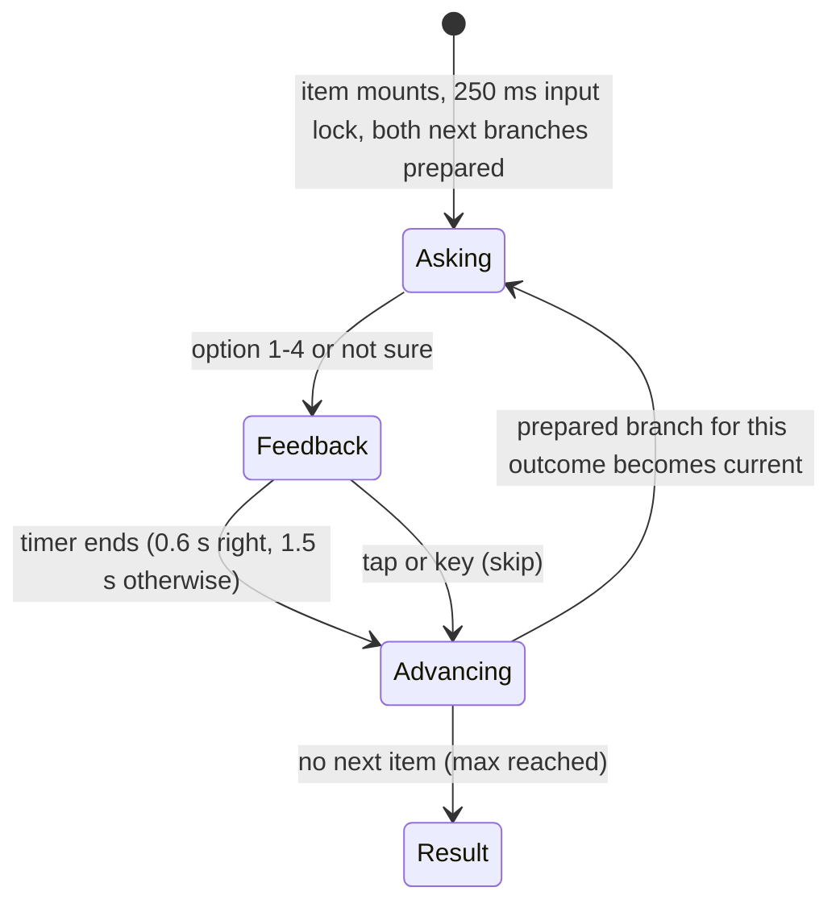
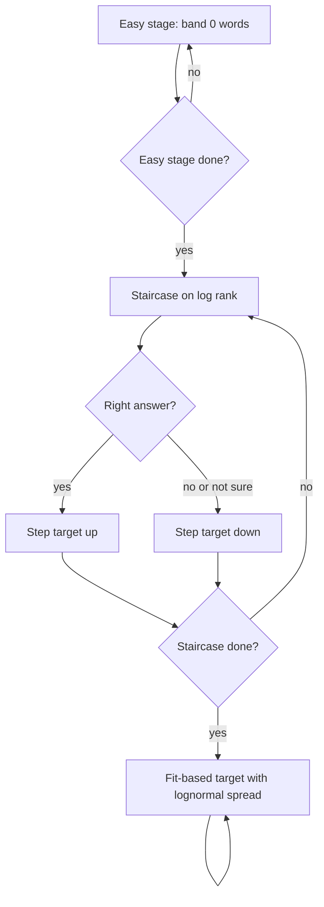

# Vocabulary Test v3 - Plan

## Goal Capsule

- **Objective:** A learner who takes the English vocabulary test at `/vocab-test` gets an estimate they can trust, starts with words they can answer, sees after each answer whether it was right, and cannot win points by option length, wording, or by changing answers.
- **Means:** Curated per-word gloss sets feed a rebuilt item generator, a staged adaptive order, and a feedback-driven test screen (KTD1, KTD3, KTD5).
- **Product authority:** The site owner. Product behavior comes from the Product Contract below; it wins over any unit text.
- **Execution profile:** Local work on branch `feat/vocab-test` in this worktree. Commit locally per unit. Do not push or deploy.
- **Stop conditions:** Stop and report if tuning cannot reach the Success Criteria accuracy, or if curation leaves any band with fewer than 30 usable words.
- **Who finishes:** `ce-work` implements and verifies; the owner tries it locally and decides on deployment.
- **Open blockers:** None.

---

## Product Contract

### Summary

Rebuild the multiple-choice vocabulary test on branch `feat/vocab-test`. Each item shows three meanings plus "none of the above", each meaning with parts of speech, up to three Chinese senses, and a short English definition. Answers get colored feedback with the correct meaning, and the next item appears automatically. The test starts with easy words and adapts its difficulty after each answer.

### Problem Frame

The current version (commits 625c307d, dc918642, 93be53bd, not deployed) asks one word from every frequency band first, so a beginner meets 30,000-rank words in the first minute. It gives no signal after an answer. Each option is one short Chinese gloss, so length and wording leak hints. An undo button lets a user see the next question and go back, which invites guessing. The owner tried it locally and judged it not ready.

### Requirements

**Item format**

- R1. Each item shows one English word, four answer options, and a separate "not sure" (不确定) button.
- R2. Options 1 to 3 are meanings. Option 4 is always "none of the above" (以上都不是).
- R3. "None of the above" is the correct answer on about one item in four, chosen at random per item, so that it is neither a safe nor a useless pick.
- R4. When "none of the above" is correct, options 1 to 3 are all wrong meanings and the word's true meaning does not appear among them.
- R5. Each meaning option shows, per part of speech, the part-of-speech label (n., v., adj., adv., ...), up to three Chinese senses, and one English definition of 8 words or fewer.
- R6. All meaning options in one item share the same layout: the same number of part-of-speech rows as the correct meaning where the pool allows, and similar text length, so no option stands out by shape or length.
- R7. Distractor meanings never share a Chinese character with the correct meaning (filler characters such as 的, 地, 了 excepted) and never contain the tested word or an obvious form of it in the English line.
- R8. English definitions use common words, list the word's most common sense first, and contain no proper-name senses (for example "crane: United States writer").

**Answer feedback**

- R9. After a correct answer, the chosen option turns light green and shows a check icon.
- R10. After a wrong answer, the chosen option turns yellow with a cross icon, and the correct option is marked light green.
- R11. After "not sure", the correct option is marked with a very light green.
- R12. When "none of the above" was the correct answer, the feedback also shows the word's true meaning (parts of speech, Chinese senses, English line).
- R13. Color is never the only signal: every feedback state also has an icon or text.

**Pacing**

- R14. The next item appears automatically: about 0.6 s after a correct answer, about 1.5 s after a wrong answer or "not sure".
- R15. A tap or key press anywhere during feedback skips the remaining wait.
- R16. Input in the first ~0.25 s after a new item appears is ignored, so a skip tap cannot land on an option of the next item.
- R17. The undo button and its keyboard shortcut are removed.
- R18. The user never waits for the next item: at least the next two candidate items are ready before feedback ends.
- R19. Keyboard: keys 1 to 4 choose an option, 0 chooses "not sure". Existing behavior; keep it.

**Adaptive order**

- R20. The test opens with a short easy stage of words from the top 1,000 that nearly every learner answers correctly.
- R21. After the easy stage, each next item gets harder after correct answers and easier after wrong or "not sure" answers.
- R22. The test no longer asks one word from every band at the start.
- R23. The minimum (20) and maximum (120) answer counts, the finish button, the live estimate panel, and the result page stay as they are, apart from changes R1 to R19 force.

**Accuracy**

- R24. The estimate model accounts for four options plus "not sure" with "none of the above" as a real answer, and still covers 0 to 40,000 words.
- R25. Before the work is called done, simulations re-run with the three learner types from the last round (linear logistic, linear ramp with noise, log logistic) at sizes from 500 to 27,000.

**Review**

- R26. After the build, the test page UI and all its text (zh-CN, en, ja, ko) are reviewed with the ui-ux-pro-max skill, and the findings are fixed.

### Key Decisions

- **Every meaning option carries an English definition, not only the feedback.** The owner chose this over showing English only after the answer and over English-only options. Option shape must then be equalized. (session-settled: user-directed — chosen over English only in feedback, and English-only options: the owner wants English on every option) Governs R5, R6, R8.
- **Feedback advances by itself.** (session-settled: user-approved — chosen over manual "next" on wrong answers and manual "next" on every item: fewer taps over 60+ items) Governs R14, R15, R16.
- **Wrong answers are yellow, not red.** The owner's request named red in one point and yellow in a later, more specific point; the later point wins. Governs R10.
- **Feedback reveals the correct answer.** Words never repeat in one test, so showing the answer costs no accuracy and gives the user something to learn. Governs R10, R11, R12.
- **Glosses are rewritten, not taken raw from the dictionary.** The ECDICT Chinese senses are usable, but WordNet English senses are out of frequency order and often long. All 480 test words get a short, checked gloss set. Governs R5, R7, R8.

### Acceptance Examples

- AE1. **Covers R2, R4, R12.** Given the word "lean" with "none of the above" as the answer, when the user picks option 2, then option 2 turns yellow, option 4 is marked light green, and the feedback shows "adj. 瘦的；贫乏的 / v. 倚靠；倾斜" with the English line.
- AE2. **Covers R11, R14.** Given any item, when the user taps "not sure", then the correct option is marked very light green and the next item appears after about 1.5 s.
- AE3. **Covers R15, R16.** Given feedback is showing, when the user taps twice fast on the spot where option 1 is, then the first tap moves to the next item and the second tap does not answer it.
- AE4. **Covers R20, R21.** Given a learner who knows the top 2,000 words, when the test starts, then the first items are top-1,000 words answered correctly, and later items cluster around the 2,000 rank.
- AE5. **Covers R6.** Given a correct meaning with two parts of speech, then each of the other meaning options also shows two part-of-speech rows of similar length.

### Success Criteria

- Simulated bias stays within about 10% for all three learner types from 500 to 27,000 words.
- The true size falls inside the shown range in 85 to 95% of simulated runs at most points, no worse than the 93be53bd baseline.
- A user who only guesses ends with a low estimate and sees the existing guessing tip.
- On a 375 px wide phone, the word and the four options fit on one screen without scrolling for typical items; the "not sure" button is at most one short scroll away.

### Scope Boundaries

- Coverage labels on book cards (轻松读 / 适合边读边查词 / 有挑战): not in this work.
- Deployment: not in this work; it needs the owner's separate approval.
- Tests for languages other than English, and English-to-Chinese direction changes: not in this work.
- Sound effects, streaks, or rewards inside the test: not in this work.

### Outstanding Questions

**Deferred to Planning**

- How the easy stage ends (fixed count vs. after N correct in a row), and how large the difficulty steps are, chosen by simulation against R25.
- How the 480 gloss sets are produced and checked (for example an LLM pass followed by a full manual review), and where they are stored.
- How R6 is satisfied when the pool has too few distractors with the same part-of-speech shape.

### Sources / Research

- Current test logic and model: `src/lib/vocab-test.ts`, tests in `src/lib/vocab-test.test.ts`.
- Current UI: `src/components/VocabTest/index.tsx`; page `src/app/vocab-test/page.tsx`; strings in `messages/src/*/vocabtest.json`.
- Data build: `scripts/build-vocab-test.py` (wordfreq ranks, ECDICT senses, 16 bands, 30 words each) writing `languages/en/content/vocab-test.json`.
- Dictionary tables with per-part-of-speech senses: `senses_i18n` (Chinese) and `senses` (English, WordNet order) in the English dictionary database.
- E2E: `e2e/vocab-test.spec.ts`.

Product Contract preservation: Product Contract unchanged.

---

## Planning Contract

### Key Technical Decisions

- KTD1. **Glosses live in a curated file that the build script validates.** A new `scripts/vocab-test-glosses.json` holds, per word, up to two rows of `{pos, zh[], en}`. The build drafts Chinese rows from ECDICT, sub-agents write the English line and check the Chinese, and the build rejects any entry that breaks R5, R7 or R8. Raw dictionary output is not good enough (bank's first WordNet sense is "sloping land"), and a reviewed file keeps the build deterministic. Governs R5, R7, R8.
- KTD2. **The data file moves to version 3.** Each word becomes `{w, r, s: [{p, zh, en}]}`. `src/lib/vocab-test-data.ts` keeps rejecting files without bands, and the client never sees version 2 data because both ship together.
- KTD3. **Distractors match the correct meaning's part-of-speech signature exactly.** A noun-plus-verb word gets noun-plus-verb distractors, taken from the same band first, then the nearest bands. Length must fall within ±40% of the correct option's character count. Relaxing to "same first part of speech" is the only fallback. Governs R6, R7.
- KTD4. **"None of the above" stays inside the existing four-choice model.** The answer index can now be 3. The likelihood in `fitAnswers` already treats any of four choices as a 1-in-4 guess, so the model math does not change. Governs R2, R3, R24.
- KTD5. **The order runs in three stages.** First a fixed easy stage from band 0. Then a log-rank staircase that steps up after a right answer and down otherwise, with a shrinking step. Then the current fit-based picking, with its center shifted up after a right answer and down after a wrong or "not sure" answer, and the lognormal spread around that center. Stage lengths, step sizes and the shift come from simulation, not from guessing. Governs R20, R21, R22.
- KTD6. **"Preload" means two prepared branches.** When an item appears, the client computes the next item for a right answer and for a not-right answer, using the same pure `nextItem`. The answer picks a branch. The simulation uses the same helper, so the measured accuracy matches what users get. (session-settled: user-approved — chosen over computing the next item only after the answer: the owner asked for two preloaded items so the test never stalls) Governs R18.
- KTD7. **Feedback is a small state machine in the component, not timers scattered across handlers.** States: asking, feedback, advancing. One timer per feedback state; skip clears it; a 250 ms input lock starts when the next item mounts. Governs R14, R15, R16.
- KTD8. **Feedback colors are new theme tokens.** `globals.css` has no success or warning tokens today. Add right, wrong and unsure surface and border tokens for light and dark, and pair each with an icon (lucide `Check`, `X`, `CircleHelp`). Governs R9, R10, R11, R13.
- KTD9. **The simulation becomes a repo script.** `scripts/simulate-vocab-test.ts` reruns the three learner types and prints bias, range coverage and margin, so the next calibration does not depend on scratch files.

### High-Level Technical Design

Item lifecycle on the test screen:

Question order across a test:

### Assumptions

- The two prepared branches are computed in an effect after the new item paints, inside the 250 ms input lock, so their cost never delays the next word. A local benchmark put one fit at about 8 ms with 120 answers, so three fits under 4x throttling are near 90 ms. U4 checks the gap with CPU throttling.
- Ten curated spares per band are enough to replace words that curation or the distractor check rejects.

### Sequencing

U1 then U2 then U3. U5 can start once U2's types settle, and U4 follows U5. U6 runs last on the finished screen.

---

## Implementation Units

### U1. Curated glosses and version 3 data

- **Goal:** Produce a 480-word pool where every word has a validated gloss set, written as version 3 data.
- **Requirements:** R5, R7, R8; KTD1, KTD2.
- **Dependencies:** None.
- **Files:** `scripts/build-vocab-test.py`, `scripts/vocab-test-glosses.json` (new), `languages/en/content/vocab-test.json`, `languages/en/content/library/vocab-needs.json` (regenerated, should not change).
- **Approach:**
  1. Add a draft mode to the build script that writes each band's 30 pool words plus its next 10 spare candidates, in the build's own slice and hash order, with their ECDICT Chinese rows per part of speech (top two parts of speech, first three senses each) and empty English lines.
  2. Fill the English lines and check the Chinese for all pool and spare words with Sonnet sub-agents in batches of about 60 words; each agent gets the rules from R5, R7, R8.
  3. Make the normal build read the curated file, validate every entry, and drop a word that fails validation or cannot get three distractors under KTD3, its fallback, the ±40% length rule and R7.
  4. Refill dropped slots only from curated spares; fail the build when a band cannot reach 30.
  5. Write version 3 output; keep the build deterministic.
- **Patterns to follow:** the existing `GLOSS_OVERRIDES` and `POOL_EXCLUDE` handling in `scripts/build-vocab-test.py`; the earlier sub-agent gloss review in this branch.
- **Test scenarios:**
  - A curated entry whose English line contains the word (for example "bank: a bank for money") fails validation and the word is replaced.
  - An entry with three part-of-speech rows or four Chinese senses in a row fails validation.
  - An entry with an unknown part-of-speech label fails validation.
  - Two runs of the build produce byte-identical output.
  - Every band in the output has exactly 30 words.
  - A word with no possible three distractors (for example a preposition whose only same-signature partners share a character) is dropped and replaced by a spare.
- **Verification:** The build passes with zero validation errors, every band has 30 words, and a manual read of 30 random entries finds no wrong or odd glosses.

### U2. Item generator, staged order and prepared branches

- **Goal:** Generate items in the new format and order, and expose the two prepared next items.
- **Requirements:** R1–R4, R6, R7, R18, R20–R22, R24; KTD3–KTD6.
- **Dependencies:** U1.
- **Files:** `src/lib/vocab-test.ts`, `src/lib/vocab-test.test.ts`.
- **Approach:**
  1. Change `VocabBand` words and `TestItem` to carry sense rows; options 0–2 are sense sets and option 3 is "none of the above".
  2. Build each item: with probability 1/4, three distractors and answer 3; otherwise the right sense set plus two distractors in shuffled positions 0–2.
  3. Pick distractors by KTD3, rejecting any whose Chinese shares a non-filler character with any target sense, or whose English line contains the tested word.
  4. Replace the first-round logic in `nextItem` with the three stages of KTD5.
  5. Add a helper that returns the next item for a right and a not-right outcome. The not-right branch is built with a hypothetical "not sure" answer, so a wrong answer gets the same next item as "not sure".
  6. Update `missedWords` to return the sense rows for the result page.
- **Patterns to follow:** current `distractors`, `sharesMeaning`, `seededRng`, and the `honest()` learner in the test file.
- **Test scenarios:**
  - Every item has three distinct sense-set options plus "none of the above", and the answer index matches where the right sense set is (or 3).
  - Over 2,000 seeded items, "none of the above" is correct between 20% and 30% of the time.
  - When the answer is 3, no option equals any of the word's senses.
  - Every distractor has the same part-of-speech signature as the right sense set when the pool allows, and its length is within ±40%.
  - No distractor's English line contains the tested word.
  - The first items come from band 0.
  - A learner who knows 3,000 words gets later items mostly between rank 700 and 13,000.
  - A learner who answers everything right reaches band 10 or higher within 25 items (provisional; U3 sets the final count from the tuned stages).
  - In the fit-based stage, the target center after a right answer is higher than after a "not sure" answer from the same state.
  - The prepared right-branch item equals what `nextItem` returns after a right answer with the same seed state.
  - The prepared not-right item equals what `nextItem` returns after a "not sure" answer with the same seed state.
  - Every word in the real `languages/en/content/vocab-test.json` yields an item with three distractors.
  - Covers AE4. A learner who knows the top 2,000 words answers the easy stage right and later items cluster near rank 2,000.
  - The test stops at 120 answers and never repeats a word.
  - Existing estimate tests (sizes 800, 3,000, 12,000; guessing; capped) still pass.
- **Verification:** All unit tests pass and the test file runs in under 60 s.

### U3. Accuracy simulation and tuning

- **Goal:** Tune the easy-stage length and staircase steps until accuracy meets the Success Criteria.
- **Requirements:** R25; Success Criteria; KTD9.
- **Dependencies:** U2.
- **Files:** `scripts/simulate-vocab-test.ts` (new), `src/lib/vocab-test.ts` (constants only).
- **Approach:** Port the scratch simulation to a repo script that uses the real data file and the prepared-branch helper. Run 150 runs per point for the three learner types at 500, 1,000, 2,000, 3,500, 5,000, 8,000, 12,000, 18,000 and 27,000 words, after 40 and 80 answers. Adjust only stage lengths and step sizes.
- **Execution note:** Record the 93be53bd baseline numbers first, then compare each change against them.
- **Test expectation:** none -- this unit measures; U2's tests guard behavior.
- **Verification:** The script prints bias within about 10% and range coverage of 85–95% at most points, and no point is worse than the baseline. The final table goes into the commit message and `readfox-todo.md`.

### U4. Test screen with feedback and pacing

- **Goal:** Show the new options, colored feedback with the right answer, automatic advance with skip, and no undo.
- **Requirements:** R1, R5, R9–R17, R19, R23; AE1–AE3, AE5; KTD7, KTD8.
- **Dependencies:** U2, U5.
- **Files:** `src/components/VocabTest/index.tsx`, `src/app/globals.css`, `e2e/vocab-test.spec.ts`.
- **Approach:**
  1. Render each sense-set option as part-of-speech rows: label, Chinese senses joined with "；", and the English line in a smaller muted line with `lang="en"`. Reserve a trailing slot for the feedback icon from the first render, so feedback never reflows text.
  2. Add the feedback state machine from KTD7; expose the state on the card with a `data-state` attribute for tests, and set it to asking only after the 250 ms input lock ends.
  3. Drop all taps and keys during the lock with no state change; the lock also covers the first item after Start.
  4. Mark the chosen and right options per R9–R12. On an item whose answer is "none of the above", show the true meaning in a slot inside the card below the options for every outcome, including a right pick.
  5. Announce right or wrong, plus the right meaning, in a live region outside the card, so the next item does not cut the announcement off.
  6. During feedback, mark options `aria-disabled` (still in the tab order); Enter, Space and any other key skip and never answer. When the next item mounts, move focus to the card so the word is read first.
  7. Remove undo and its handler; keep keys 1–4 and 0.
  8. Skip the color transition under `prefers-reduced-motion`.
  9. Show the sense rows in the result page's missed-word list.
  10. Update the e2e helpers to skip feedback with a tap and wait for the asking state before each answer, and raise the vocab spec's test timeout above the 30 s default.
- **Patterns to follow:** existing `Button` variants and `min-h-11`/`min-h-12` touch sizes in this component; theme tokens in `src/app/globals.css`.
- **Test scenarios:**
  - Covers AE1. With a seeded item whose answer is "none of the above", choosing option 2 shows option 2 as wrong, option 4 as right, and the true meaning text.
  - Covers AE2. Choosing "not sure" marks the right option as unsure-colored and the next word appears after the delay.
  - Covers AE3. A double click during feedback advances once, and the second click does not record an answer.
  - Pressing 1 answers option 1; pressing a key during feedback skips the wait.
  - Pressing Enter on a focused option during feedback skips and records no second answer.
  - A key press in the first 250 ms of a new item records nothing.
  - The undo button no longer exists.
  - Answering 20 items enables the finish button, and the result page lists missed words with their senses.
  - All "not sure" answers still end at level A1 with an estimate below 500.
- **Verification:** The vocab e2e spec passes; with 4x CPU throttling in the browser, the gap between feedback end and the next word is not visible.

### U5. Copy in four languages

- **Goal:** Add and update all test-screen text.
- **Requirements:** R2, R10–R13, R17.
- **Dependencies:** U2.
- **Files:** `messages/src/en/vocabtest.json`, `messages/src/zh-CN/vocabtest.json`, `messages/src/ja/vocabtest.json`, `messages/src/ko/vocabtest.json`, merged message files.
- **Approach:** Add strings for "none of the above", right, wrong, the correct meaning label and the skip hint. Remove the undo string. Update the intro and hints to mention "none of the above" and automatic advance. Run `node scripts/merge-messages.mjs`.
- **Test expectation:** none -- copy only; U4's e2e spec covers rendering.
- **Verification:** The merge script runs clean and no locale is missing a key.

### U6. UI and copy review, then fixes

- **Goal:** Review the finished screen with the ui-ux-pro-max skill and fix what it finds.
- **Requirements:** R26; Success Criteria (phone fit).
- **Dependencies:** U4, U5.
- **Files:** `src/components/VocabTest/index.tsx`, `src/app/globals.css`, `messages/src/*/vocabtest.json`.
- **Approach:** Review contrast of the three feedback colors in light and dark mode, touch sizes, focus order, reduced motion and copy clarity. Check a 375 px wide phone layout with a two-row option item. Fix in order of severity.
- **Test expectation:** none -- review and styling; U4's e2e spec guards behavior.
- **Verification:** Feedback colors meet 3:1 non-text contrast against the card and text stays at 4.5:1. On a 375 px phone the word and four options fit without scrolling for a one-row item; a two-row item is also checked and the result reported. Screenshots of light, dark and phone views are shared with the owner.

---

## Verification Contract

| Gate | Command or check | Applies to |
|---|---|---|
| Types | `npx tsc --noEmit` | U2, U4 |
| Lint | `npm run lint` | U2, U4 |
| Unit tests | `npm test` | U2 |
| Data build | build script with `--dict` against the local English dictionary database | U1 |
| Accuracy | `bun scripts/simulate-vocab-test.ts` | U3 |
| E2E | `npm run test:e2e -- e2e/vocab-test.spec.ts` on the spare ports from the project's e2e notes, with `public/__env.js` pointed at the spare API port and restored afterwards | U4 |
| Messages | `node scripts/merge-messages.mjs` | U5 |
| Production build | `npm run build` | all |
| UI review | ui-ux-pro-max review with screenshots | U6 |

---

## Definition of Done

- Every unit's verification holds and every gate above passes.
- Accuracy numbers meet the Success Criteria and are recorded.
- No undo code, version 2 data handling, or abandoned experiment code remains in the diff.
- Each unit is committed locally on `feat/vocab-test`; nothing is pushed or deployed.
- `public/__env.js` and `.claude/launch.json` are back to their committed state.
