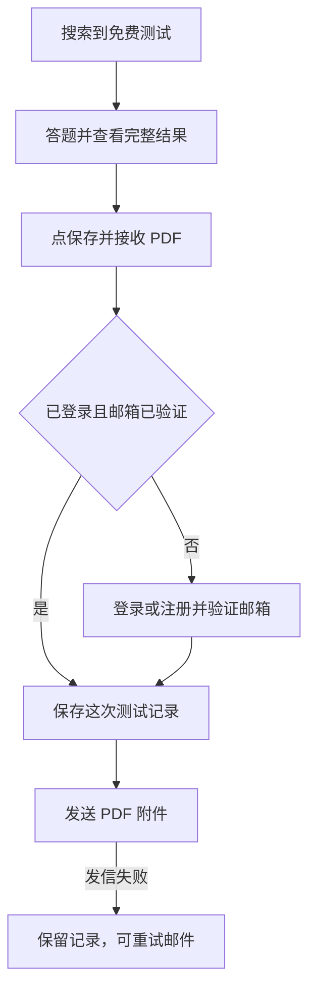
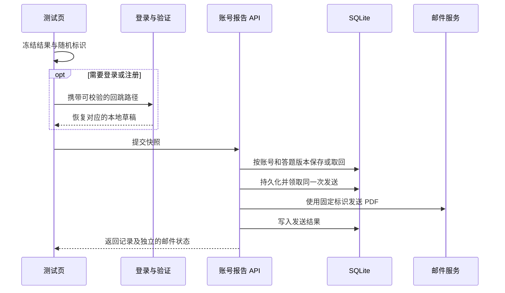
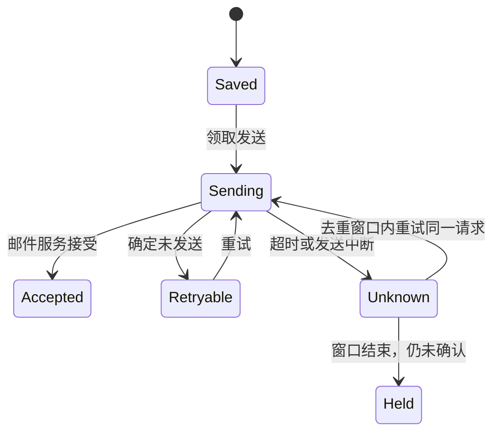

# Readfox 免费词汇测试保存与 PDF 报告 - Plan

## Goal Capsule

- **目标**是让搜索到 Readfox 的英语学习者直接测出词汇量，并在想留存结果时把报告保存到账号、发到邮箱。
- **产品范围**是现有公开测试页、结果页、登录和注册回跳、账号测试记录及结果邮件。
- **草案选择**是让「保存并接收 PDF」一次完成两件事，报告发到账号已验证的邮箱。

- **实施边界**以本文档的验收和代码评审为交付条件。若发现改动必须改变产品范围或数据归属，先回到需求确认。部署按仓库现有流程另行确认。

---

## Product Contract

### Summary

沿用已上线的 `/vocab-test` 作为可被搜索引擎发现的免费入口。访客做完即可看完整结果，主动点「保存并接收 PDF」时才进入登录或注册流程。

### Requirements

**公开测试与搜索入口**

- R1. 未登录访客可以免费开始英语词汇测试并查看完整网页结果，包括词汇量估计区间、参考等级和现有阅读推荐。
- R2. `/vocab-test` 保持为可索引的公开页面。页面标题、说明和常见问题应直接说明免费、无需登录即可测试和查看结果，以及结果代表什么。

**账号保存**

- R3. 结果页提供「保存并接收 PDF」。未登录用户点该按钮时可选登录或注册。
- R4. 在同一浏览器完成登录或注册及所需的邮箱验证后，继续保存发起操作时的那份结果，无需重新答题。
- R5. 免费账号可以从自己的测试记录查看已保存的结果。对同一份结果重复提交时，只保留一条记录。
- R6. 用户通过独立的「设为我的阅读等级」操作来应用等级，保存报告时继续使用当前阅读等级。

**PDF 与邮件**

- R7. 成功保存后，将与记录一致的 PDF 作为附件发送到该账号已验证的邮箱。
- R8. PDF 采用一页的 Readfox 评估报告版式。内容包括测试日期、词汇量估计区间、参考阅读等级和推荐读物。报告以简短说明解释估计区间及等级的用途。
- R9. 结果页分别反馈保存和发信状态。发信失败时记录仍可查看，并可重试发送。重复点击同一次提交只发一封结果邮件。
- R10. Readfox 中只有该账号本人能访问保存的结果和报告。

### Key Flows

- F1. 访客从搜索进入测试页，答题后查看完整结果。到这里就可以离开，也可以主动保存。参考 R1–R3。
- F2. 用户点「保存并接收 PDF」，按需登录或注册并验证邮箱。Readfox 保存这次结果并发送附件。参考 R3–R10。

### Acceptance Examples

- AE1. **Covers R1–R3.** 退出登录后打开公开测试页，能看到介绍、开始答题并读到完整结果。仅在点击保存时出现登录或注册提示。 站点地图指向公开测试页，页面允许索引。
- AE2. **Covers R3–R8, R10.** 访客选择保存，在同一浏览器完成注册和邮箱验证。账号里出现刚测的那次记录，PDF 发到该账号的邮箱。邮件附件与网页的估计区间和参考等级一致，阅读等级仍使用原设置。另一账号无法访问这份报告。
- AE3. **Covers R5, R7, R9.** 连续点两次保存，账号只出现一条记录。若发送失败，页面显示记录已保存和邮件可重试。重试成功后收到一封带 PDF 附件的邮件。

### Scope Boundaries

沿用现有英语词汇测试和估分方式。PDF 用于个人学习，呈现参考等级和区间估计。

<!-- ce-section: work-relationships -->
### How This Work Fits Together

本次覆盖从免费测试到账号留存的流程。[点词收藏与朗读](2026-11-12-1014-feat-reader-lookup-controls-plan.md)属于网页阅读器，可以独立推进。

### Outstanding Questions

**Deferred to Planning**

- 验证现有登录、邮箱验证及新手引导之间的回跳，确保同一次测试结果可以恢复。
- 确认 PDF 中文和拉丁字母在常见 PDF 阅读器里的显示效果，并用真实版式校对一页内的排版。

### Sources / Research

公开测试页已上线，提供免费答题入口和常见问题。页面已有标题、结构化数据和站点地图条目。 [Readfox 免费英语词汇测试](https://readfox.app/vocab-test)

代码基线为 `origin/selfhosted` 的 `3fcdc307`。目前浏览器保存最近一次的估值、参考等级和日期，账号可手动采用参考等级。见 `src/lib/vocab-result.ts:3` 和 `src/components/VocabTest/SaveLevel.tsx:27`。

账号注册已有邮箱验证，邮件模块支持附件。见 `api/src/lib/accounts.ts:273` 和 `api/src/lib/email.ts:41`。

---

## Planning Contract

**Product Contract unchanged.** 以 `origin/selfhosted` 的 `3fcdc307` 为实施基线。公开页已经可访问，现有实现只把最近的估值和等级留在浏览器，另有独立的「设为我的阅读等级」动作。

### Key Technical Decisions

- KTD1. **冻结用户点保存时看到的那次结果。** 每个可保存的答题版本有独立的随机标识。浏览器暂存估计区间的显示类型、参考等级、测试日期、界面语言及推荐书目引用。登录、注册、二次验证及 OAuth 共用现有回跳校验，仅增加受限的测试页恢复路径和不含个人数据的标识。邮箱验证在同浏览器的新标签页打开时也可恢复。已知登录或注册目标时，把草稿绑定该目标，只有匹配的已验证会话可以自动继续。回跳有错误时停在恢复界面。目标无法确认时，先显示当前已验证账号，由用户确认保存给该账号。Governs R1, R3–R6. [Better Auth 邮箱验证](https://better-auth.com/docs/concepts/email)
- KTD2. **服务器保存账号私有的结果快照。** 在 Hono 的浏览器会话路由内校验格式、范围和书目。用户身份与收件邮箱从已验证的账号读取。提交同时携带页面确认过的账号标识，服务器将其与会话账号比较，防止标签页切换账号后保存给另一人。SQLite 对账号和答题版本设唯一约束，重复提交返回已有记录。原始答案不上传。结果用于个人学习，使用有范围校验的浏览器估值，沿用现有估分流程。Governs R4–R7, R10.
- KTD3. **在 Hono 生成 PDF。** 用 PDFKit 和随镜像发布的可嵌入 Noto 字体，从已保存的数据生成单页报告。标题、估计区间、参考等级、说明和书目使用统一的显示规则。长书名按可用高度换行或缩短书目列表。字号保留可读范围。Governs R7, R8. [PDFKit 字体及排版](https://pdfkit.org/docs/text.html#fonts) · [Noto CJK 字体授权](https://raw.githubusercontent.com/notofonts/noto-cjk/main/Sans/LICENSE)
- KTD4. **先保存记录，再发送附件。** 记录与发送状态分开，复用邮件模块。首次发信前保存稳定的请求标识、收件人和完整邮件内容。超时或进程中断后，只在 Resend 去重窗口内以同一个标识和相同内容重试。超出窗口且仍无法确认是否已发送时保留「发送状态待确认」，不自动重新发信。收到服务接受响应后显示「已发送」，文案只承诺服务已接受。Governs R7, R9, R10. [Resend 幂等规则](https://resend.com/docs/dashboard/emails/idempotency-keys)

### High-Level Technical Design

公开测试页继续只加载测验和公用说明。确认保存后才创建短期浏览器草稿，注册流程在完成验证后回到同一个草稿。私有历史从账号 API 读取，公开结果页的索引和阅读等级设置继续独立。

| 内容 | 保存位置 | 生命周期 |
| --- | --- | --- |
| 待续办结果 | 浏览器 | 以邮箱验证有效期为上限，匹配成功后清理 |
| 测试报告摘要 | 账号下的 SQLite 记录 | 账号记录，可随数据导出和删除 |
| 邮件附件与完整请求 | 受保护的待发送记录 | 只为重试保留，确认发信或彻底结束重试后清理 |
| 发送结果 | 账号下的发送状态 | 支持查看与重试，记录服务返回的消息 ID，供核对发送结果 |

### Risks and Implementation-Time Questions

- 用现有验证邮件流程测试登录回跳与注册回跳，特别是同浏览器跨标签页、多份草稿和旧链接。存储不可用或草稿过期时给出恢复提示，保留用户仍可打开的本地结果。
- 报告发送使用用户明确触发的结果邮件，区别于产品推广邮件。以文件邮件传输做集成测试。只有控制台日志的部署应显示发信不可用，并保留已保存报告。
- 在仓库实际的 Bun 和 amd64 Alpine 镜像中确认字体、PDFKit 和文件路径。以简繁中、英、日、韩和最长书名验证单页排版。验证语言字符串时区分测试日期与邮件发送日期。
- 使用仅新增表或字段的迁移。旧版本可共用数据库，报告加入账号数据清理和用户数据导出。用户导入数据时只重建报告元数据。服务端 SQLite 灾备副本包含实际发送状态，灾备恢复后启动服务不会自动发送待处理邮件。

---

## Implementation Units

### U1. 冻结测试结果并安全回跳

**目标**保留用户点保存时的原结果，沿用登录和注册流程。覆盖 R3、R4、F2、AE2。无前置单元。

**文件** `src/components/VocabTest/index.tsx`、`src/lib/vocab-report-draft.ts` 与 `src/lib/vocab-report-draft.test.ts`（新增）、`src/lib/auth-return.ts`、`src/lib/auth-return.test.ts`、`e2e/auth-cloud.spec.ts`。按需接入 `src/app/(auth)/{login,register,two-factor}/page.tsx` 和现有 OAuth 按钮。

**做法**用现有结果对象生成独立的、可恢复的保存草稿。相同答题版本使用同一标识，继续答题后新结果使用新标识。回跳仅允许固定公开测试页、固定恢复参数和合法草稿标识。浏览器收到回跳后恢复对应草稿，确认会话已验证再续办。现有测试页面免登录与阅读等级应用流程继续由各自入口处理。

**测试场景**

- Covers AE2. 登录或注册验证后恢复发起时的同一份草稿。一个浏览器中的 A、B 两份草稿不会互换。重复回跳提交同一答题版本。
- 过期、损坏、不可读的草稿有可恢复提示。其他 URL、意外参数和伪造标识无法触发回跳或提交。
- 账号 B 登录时打开账号 A 已用过的验证链接、过期链接或提交前切换会话，均不保存到 B。OAuth 等无法预先确认目标的回跳先展示账号，等用户确认。现有套餐登录回跳、邮箱验证和两步验证保留原行为。

**验证**回跳验证测试与实际邮箱验证流程能证明同一份草稿贯穿页面跳转。

### U2. 增加私有测试记录和账号数据归属

**目标**保存、读取与去重结果，账号之间隔离。覆盖 R4–R6、R10、F2、AE2、AE3。与 U1 共用结果快照的字段定义。

**文件** `api/src/db.ts`、`api/src/routes/registry.ts`、`api/src/routes/vocab-test-reports.ts` 和 `api/src/routes/vocab-test-reports.test.ts`（新增）、`api/src/lib/openapi/annotations.ts`、`api/openapi.json`、`api/src/lib/account-deletion.ts` 及其测试、`api/src/lib/adopt-local-data.test.ts`、`api/src/lib/user-export.ts`、`api/src/routes/data.ts` 及其测试。

**做法**新增仅供浏览器已验证账号访问的报告资源，遵循现有 Hono 会话和账号限制。验证小体积的版本化快照，使用服务器侧书目引用，所有读写按账号过滤。重复提交返回原快照。记录与发送可重试状态分开。导出与恢复支持可选的报告元数据，对旧备份按空处理。只从备份恢复的记录可查看，邮件状态保持为无需发送。恢复遇到同一份已有报告时保留现有的发送状态。后续重复保存两种记录都只返回已有结果。

**测试场景**

- Covers AE2. 登录用户只见自己的结果，另一账号用同 ID 不能读取或重试。无会话、未验证邮箱、PAT 和本地伪账号不能通过报告路由触发邮件。
- Covers AE3. 同账号并发保存同一个答题版本只写入一条记录。新答题版本得到新记录，阅读等级保持原值。
- 反向区间、未知书目、异常值或过大快照返回校验错误。删除账号清理报告和待发内容。旧备份可恢复，新备份恢复报告数据且无发信。导入旧备份不会重置已经发送的状态，随后重复保存也不会重新发信。

**验证**隔离数据库 API 套件覆盖唯一性、数据归属、增量迁移和导出、恢复、删除边界。

### U3. 生成一页 PDF 并随镜像打包字体

**目标**生成与已保存记录一致、可打开的 PDF 附件。覆盖 R7、R8、AE2。依赖 U2 的稳定快照。

**文件** `api/src/lib/vocab-test-report-pdf.ts` 与 `api/src/lib/vocab-test-report-pdf.test.ts`（新增）、`api/src/assets/vocab-report-fonts/`（字体与授权）、`api/package.json`、`api/bun.lock`，构建需要时调整 `Dockerfile`。报告文案沿用项目现有语言目录或 API 本地化约定。

**做法**在服务端用嵌入字体渲染结果。安排报告标题和测试日期、词汇量区间和参考等级、估计说明、推荐读物四块内容。复用公开结果的区间及上限格式。通过字体实际度量控制换行和页面高度。

**测试场景**

- Covers AE2. 示例报告页数为一、文本可提取、区间与记录一致。保留上限格式和报告日期。
- 简繁中、英、日、韩、长书名以及没有合适读物的报告能清楚显示。用渲染后的页面检查溢出和缺字。
- 字体或生成失败时返回明确错误，不向邮件服务提交空附件。用目标 Docker 镜像生成报告确认打包。

**验证**报告可在常见阅读器打开，内容和版面在实际产物上通过检查。

### U4. 发送附件、处理重试并显示邮件状态

**目标**让保存成功和邮件发送各有独立状态。覆盖 R7、R9、R10、AE2、AE3。依赖 U2、U3。

**文件** `api/src/lib/email.ts`、`api/src/lib/email.test.ts`、`api/src/lib/vocab-test-report-delivery.ts` 与 `api/src/lib/vocab-test-report-delivery.test.ts`（新增）、`api/src/routes/vocab-test-reports.ts` 及其测试。

**做法**以账号报告作为发送单元，用数据库条件更新领取一次发送。服务端从账号读取收件人，重试同一已验证地址。发送调用支持可选的 Resend 幂等键和接受结果，现有调用方保留默认行为。每次发送前确认当前账号仍存在且原收件邮箱仍是已验证地址。以同一标识重放完全相同的请求，区分确定未发送与接收状态不明。日志和接口只记录必要的错误类别或发送状态，避免输出邮箱、报告内容和邮件服务的原始错误响应。状态过期或地址已更改时先处理不明结果，避免把同一份报告重复发出。沿用现有写入频率限制方式控制该入口。

**测试场景**

- Covers AE3. 两个并发请求只产生一次发送。相同报告重试的收件人、PDF 内容和幂等键一致。
- 生成失败或确定拒绝可重试。模拟服务已接受但客户端超时，窗口内重试复用服务结果，窗口结束后显示待确认。进程重启后同样有效。
- 邮件不可用时报告仍可读。文件传输能观察到真实 PDF 附件、正确收件人和独立的发送状态。

**验证**邮件接收成功、发送失败和不明状态都有可重复的测试，报告数据在各路径中均保留。

### U5. 接通免费入口、账号历史和隐私文案

**目标**交付访客到报告留存的完整体验。覆盖 R1–R10、F1、F2、AE1–AE3。依赖 U1–U4。

**文件** `src/app/vocab-test/page.tsx`、`src/app/vocab-test/history/page.tsx`（新增）、`src/components/VocabTest/index.tsx`、`src/components/VocabTest/SaveLevel.tsx`、`src/lib/vocab-test-report-client.ts`（新增）、`src/app/sitemap.ts`（核对）、`e2e/vocab-test.spec.ts`、`e2e/auth-cloud.spec.ts`、`src/lib/api-base.ts`（核对公开路径边界）、`messages/src/*/{vocabtest,legal}.json` 及生成目录，另有 `src/app/privacy/page.tsx` 和相关流程文档。

**做法**保留公开题目、结果和推荐，沿用已有标题、说明、结构化数据与站点地图入口。把结果页注册提示收敛到主动保存。账号历史链接可从测试页找到。由于公开路径匹配会放行整个 `/vocab-test/*`，在历史页加独立的已验证会话门槛，未登录时走登录流程。私有历史排除索引，报告 API 返回私有、不可缓存的响应。结果页显示保存状态和发送状态，只有可重试时提供重试入口。隐私文字说明主动保存哪些数据，以及报告邮件的用途。

**测试场景**

- Covers AE1. 访客通过可索引的页面进入，完成测试并看到结果和书目。保存前没有登录弹窗。
- Covers AE2. 在验证邮件的新标签页完成注册，从原结果进入账号历史并核对 PDF。账号 B 无法访问账号 A 的记录。
- Covers AE3. 邮件失败时仍能在历史查看报告，重试后收到一封附件邮件。普通测试与手动设为阅读等级依旧可用。

**验证**以真实浏览器、隔离邮箱和目标 Docker 镜像跑通公开入口、账号保存、附件、重试及隐私边界。

---

## Verification Contract

- 前端使用 Vitest、`e2e/vocab-test.spec.ts`、`e2e/auth-cloud.spec.ts` 和生产构建。登录回跳及报告格式以跨页、跨标签页流程验证。
- API 使用隔离的 `bun run test`，覆盖账号隔离、并发去重、邮件重试、旧库升级和账号数据生命周期。运行 `npm run gen:openapi:check` 验证内部路由注解。
- 在目标镜像生成并打开五种界面语言的报告样本。文件邮件传输验证附件与页面数据一致，公开测试页验证可索引，私有历史验证会话隔离。
- 依 `AGENTS.md` 更新 `docs/flows/{auth,vocabulary,data}.md` 和 `docs/flows/graph-data.js`，通过 `node docs/flows/validate-graph.mjs`。
- 依 `AGENTS.md` 更新 `README.md` 的相关功能说明，并对 `README.md`、`CONTRIBUTING.md` 和 `deploy/README.md` 运行 STE 检查。

---

## Definition of Done

- U1–U5 的验收均通过。访客免费查看结果，登录或注册验证后能保存同一次结果并收到一致的一页报告。
- 同账号重复提交只有一条历史记录，发信失败保留记录并支持相应重试。账号隔离、导出和删除测试通过。
- 公开页索引入口、五种界面语言、隐私文案、流程图和镜像内 PDF 均已核对。清理临时邮件与调试代码。
