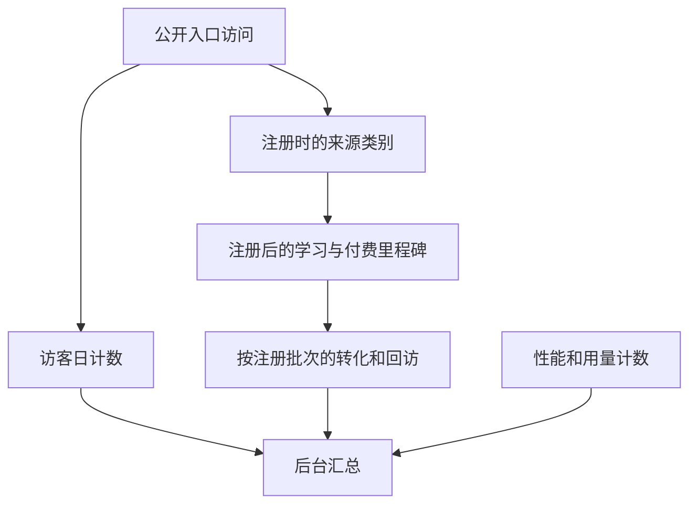
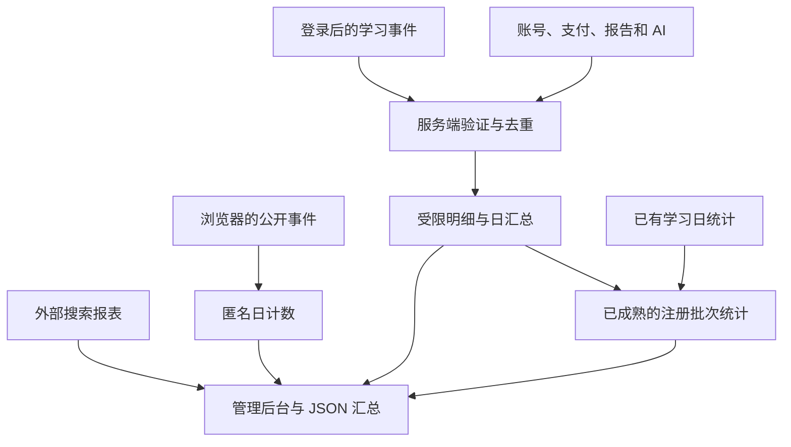

# Readfox Product Analytics - Plan

## Goal Capsule

- 从正式站采集可用于产品决策的第一方数据，让后续能追溯获客、首次阅读、学习回访、付费和服务质量。
- 产品范围以 2026-11-13 确认的采集范围和保留期限为准。后台使用汇总数据，访客按日统计，注册后可在站内关联首次来源与学习回访。
- 从当前 `origin/selfhosted` 建立独立分支，交付通过本地验证的 PR。

---

## Product Contract

### Summary

在 Readfox 现有的获客统计、学习记录和运营后台上补齐产品事件。上线后持续保留学习流程中的关键节点、渠道转化、支付结果和服务质量，并在详细事件到期前生成可长期分析的汇总。

### Problem Frame

正式站已经有匿名访问与注册计数、每日学习统计、复习日志、保存的词汇测试报告、配额用量和 AI 耗时分布。普通阅读中的打开、实际阅读、完成和续读缺少同一口径的记录。现有引导事件覆盖部分新手流程，免费账户默认上限是 50 条。词汇报告只覆盖主动保存的结果。匿名渠道计数无法回答来源对应的注册用户是否继续学习。

访问日志每 20 MiB 轮转，最多留 10 个归档、720 小时。AI 耗时分布约保留 90 天。2026-11-13 已将仍可读取的正式站访问日志和现有指标提取为独立汇总快照。访问日志覆盖 11 月 3 日至 13 日，学习活动覆盖 10 月 15 日至 11 月 13 日。快照是回溯基线，实际采集起始日按数据来源分别标记。

### Key Decisions

- **首批优先记录无法事后重建的行为。** 首次读完、继续阅读、复习入口和测评中断先补齐。已有学习统计、支付结果、AI 指标和正在开发的界面语言归因优先复用。
- **按访问和账号阶段处理。** 访客只贡献有限维度的日计数。注册时在第一方范围内保留来源类别，供后续计算该批注册者的阅读与回访。后台提供汇总，账户关联受删除和保留期限约束。
- **保留周期。** 新增产品分析的详细事件保留 90 天，汇总保留 24 个月。现有学习历史、词汇报告及备份有各自的业务保留规则。

### Actors

- A1. 访客在公开页、书库、阅读预览、词汇测试和注册入口产生计数。
- A2. 注册学习者在阅读、复习、测评和支付流程中产生状态变化。
- A3. Readfox 运营者用汇总数据核对渠道、学习回访和功能使用情况。

### Requirements

**获客与回访**

- R1. 按日记录公开入口、来源渠道、公开推广活动和适用的语言维度。来源和推广活动使用可控分类。浏览器语言、界面语言、释义语言和学习语言各有独立含义。
- R2. 记录注册提交、验证、引导开始与结束，以及首次有效阅读。注册时来源可用则用于后续同批用户汇总，来源缺失时显示为未知。
- R3. 计算注册次日、第 7、14、30 天的学习回访，并保留每项符合观察条件的人数。另行计算注册后 14 天内至少在两个不同日期查词的比例，供现有产品复盘使用。

**学习过程**

- R4. 记录推荐或搜索结果的打开、开始有效阅读、完成一段可测量的内容和下次续读。区分公开预览、站内推荐和用户导入等内容来源。
- R5. 记录有效阅读时长、进度里程碑、查词与句子帮助、保存词汇、音频使用和可选的难度反馈。使用公开内容标识或内容类别支持分级材料分析。
- R6. 记录复习入口到达、存在待复习词、开始、答题结果、完成及再次复习。通过题型、是否记起和间隔区间比较复习体验。
- R7. 记录词汇测评开始、达到题量里程碑、结果生成、报告保存与投递状态、采纳推荐等级及打开推荐阅读。测评答案留在浏览器。
- R8. 记录导入、听读和 AI 辅助功能等主要能力的开始、成功与失败。只采集用途对应的分类和结果。

**收入与服务质量**

- R9. 记录价格页、触及配额、支付启动、成功或失败、退款和取消，用现有订单与订阅事实核对支付结果。
- R10. 按功能和版本汇总可观测的耗时、成功、失败、超时、重试、缓存命中、额度和提供方返回的 token 用量。标记 token 覆盖情况以免将部分记录视为完整成本。
- R11. 保留已接入且可授权读取的外部搜索渠道汇总，包括曝光、点击、平台提供的汇总搜索词和公开落地页。标明来源与覆盖日期。

**保留与可信度**

- R12. 运营分析使用受控事件和字段。用户阅读内容、导入内容、查词文本、作答文本、聊天、日记、原始 URL 与账号凭据继续由各自的业务流程管理。
- R13. 新增详细事件在 90 天后到期，日汇总保留 24 个月。账号删除清除新增可关联的分析记录，符合汇总口径的历史计数可以保留。
- R14. 只向运营后台展示汇总。现有第一方原则和账户删除承诺适用于采集、保留、查询和导出。数据处理变化随同功能更新公开隐私说明。
- R15. 同一业务动作因重试、刷新或客户端切换产生的重复上报应去重。正式站与 Beta 分开统计，内部测试账号与爬虫在能够识别时单独处理。
- R16. 标记指标定义、数据来源、版本和可用起点。历史数据仅使用可核验的来源补录，采集缺失用缺失状态表示。
- R17. 采集失败可被发现，学习、注册和支付仍按各自流程运行。可从后台取得机器可读的汇总用于复盘。

### Key Flows

- F1. 访客从公开页进入。站点累计当天的来源和入口计数。成功注册时保留可用的来源类别。运营者可按渠道查看有足够观察期的注册者有多少完成首次阅读或回来学习。
- F2. 学习者打开材料并开始阅读。记录有效活动、完成标记和后续续读，复习或测评各自产生简要状态。汇总可辨别用户停在选材、首次阅读或开始复习之前。
- F3. 事件按日汇总。汇总保留至约定期限。详细事件到期或账户删除时移除相应明细。

### Acceptance Examples

- AE1. 从一个已知推广渠道进入并完成注册后，渠道的注册批次可用于计算首次阅读及回访。缺少来源的注册仍计入总分母。
- AE2. 用户打开读物、查词、完成一章并于下次续读。后台能区分各阶段，读物只打开过的用户不计入完成。
- AE3. 用户做测评但未保存报告。开始与完成计数仍能反映这次使用，答案仍留在浏览器。
- AE4. 注册满 7 天并完成第 7 天观察窗口的账户进入 D7 分母。只在第 8 天出现的学习活动归入第 8 天，另可计入七天后回访。
- AE5. 支付回调重试产生一次成功计数。后续退款分别保留成功和退款的时间与金额。
- AE6. 可关联事件在账号删除或到期时移除。历史汇总继续可查，并保留数据覆盖日期。

### Scope Boundaries

现有仓库原则规定产品分析使用第一方数据、运营后台只看汇总，测试答案留在浏览器。此次重点是记录现有流程和验证指标。问卷访谈、题型扩充、推荐算法调整和新的产品入口可基于收集结果独立决定。

### Sources

- 仓库数据处理原则和部署约束。[AGENTS.md](../../AGENTS.md)
- 正式站 `174bb058` 的日统计、回访定义、渠道与性能采集。[运营统计](https://github.com/Huu-Xiang/lector/blob/174bb058f023d6cf45c0b94bba7d74a3a5d56e01/api/src/lib/admin-trends.ts) · [AI 耗时](https://github.com/Huu-Xiang/lector/blob/174bb058f023d6cf45c0b94bba7d74a3a5d56e01/api/src/lib/ai-timing.ts) · [Caddy 配置](https://github.com/Huu-Xiang/lector/blob/174bb058f023d6cf45c0b94bba7d74a3a5d56e01/deploy/readfox/Caddyfile)
- 现有公开说明涉及访问日志、统计、账号删除与测试数据处理。[隐私说明](../../messages/src/en/legal.json)

---

## Planning Contract

### Key Technical Decisions

- **复用现有业务入口。** 在正式动作或持久化结果旁采集。保持引导事件、订阅镜像、学习日统计和原有访问来源计数的现有口径。独立分析记录和聚合走同一 SQLite 数据库的新增表。
- **匿名事件即时聚合。** 公开页和测评访客使用限频、短生命周期的随机动作凭据去重。公开入口使用已知路由类别，活动使用已知标签。服务端采用字段白名单和独立的已登录入口。
- **账号事件可删除。** 以会话或服务端已验证的业务事实确定账号，使用事件去重和服务端时间。按环境区分数据，详细记录和去重凭据按 90 天清理，日汇总保留 24 个日历月。
- **在观察窗结束后固化批次结果。** 新事件用 UTC 日期做精确回访。早期日统计用相同的学习者本地日期比较注册日期和活动日期，并标记为历史估计。对新口径缺失的观察期显示覆盖缺口。账户删除后的可关联明细清除，已形成的匿名汇总继续可查。
- **支付与 AI 以已知事实计数。** 支付尝试、已结算、失败、退款、取消分开。第三方回调使用已验证的业务 ID 去重。AI 记录耗时分桶与 token 覆盖，按功能和受控发布版本汇总。
- **外部搜索导入可独立使用。** 通过管理员导入已授权的搜索报表，保存来源、日期、公开页面和平台披露的查询。平台数据可能只覆盖部分查询，报表明确显示导入覆盖。[Search Console 数据说明](https://developers.google.com/webmaster-tools/v1/searchanalytics/query)

### Assumptions

- 采用 60 秒可见且近期有互动作为有效阅读信号。读完要求有效阅读和新达到 90% 进度，短内容使用可见终点。分别记住两个条件，满足时记录。恢复的滚动位置不触发进度信号。
- 除专门的 14 天查词指标外，回访活动包括阅读、查询和复习等实际学习事件。历史补录不根据会话 ping、导入时的 lastReadAt 或页面缓存推断阅读完成。
- 有账号的测评仅记录题数里程碑和操作结果。访客测评按匿名日总数计算，跨注册衔接依赖当前站点支持的来源信息。
- 搜索报表以手动导入为初始可交付入口。真实 Google、Bing 数据范围取决于平台权限。

### High-Level Technical Design

同一动作重试沿用去重凭据。汇总写入与去重记录采用一个事务。匿名动作凭据最长保留 48 小时。账户来源和账户去重记录与明细一起到期，并纳入账户删除。批次固化和清理一起提交，失败可重试，后台报告最近一次成功维护。管理员只读取固定分组的聚合行，低样本量的账户衍生分组并入其他项。

---

## Implementation Units

### U1. 存储、验证、汇总和删除

- **Goal** 提供有界的匿名及账户采集、时间窗口和机器可读汇总。覆盖 R3、R12–R17、AE4、AE6。
- **Files** `api/src/db.ts`、`api/src/lib/product-analytics.ts`、`api/src/lib/product-events.ts`、`api/src/routes/product-analytics.ts`、`api/src/routes/registry.ts`、`api/src/lib/session.ts`、`api/src/lib/billing.ts`、`api/src/lib/account-deletion.ts`、`api/src/index.ts`、`api/src/routes/admin.ts`。
- **Patterns** `source-count.ts` 请求限制、`admin-trends.ts` 运营者权限与日期统计、`account-deletion.ts` 租户擦除、现有 worker 启动方式。
- **Test scenarios** `api/src/lib/product-analytics.test.ts` 覆盖去重、账号删除、到期前固化、D7 成熟分母、错误路径不影响主流程。公开接口拒绝任意属性、伪造用户和未知类别。校验非运营者无法读取汇总。

### U2. 获客、注册和后台

- **Goal** 将入口分类、活动、语言和注册关联接入已有获客与后台流程。覆盖 R1–R3、R14、R17、AE1。
- **Dependencies** U1。
- **Files** `src/components/SourceBeacon/index.tsx`（含价格页）、`src/lib/traffic-source.ts`、`api/src/lib/accounts.ts`、`api/src/lib/source-list.ts`、`api/src/routes/onboarding.ts`、`src/app/admin/Trends.tsx`、`src/lib/admin-client.ts`、各界面语言的隐私文案。
- **Test scenarios** `e2e/admin-cloud.spec.ts` 验证真实注册来源和汇总访问。已有邮箱、OAuth 登录、刷新和缺失来源得到正确的分类与计数。

### U3. 阅读和练习客户端

- **Goal** 在阅读、推荐、复习、测评和导入的实际交互处记录关键节点。覆盖 R4–R8、AE2、AE3。
- **Dependencies** U1。
- **Files** `src/lib/product-analytics.ts`、`src/lib/use-reading-activity.ts`、`src/app/read/[bookId]/page.tsx`、`src/components/MarkdownReader`、`src/components/RecommendedForYou`、`src/components/FreeBooksModal`、`src/app/practice/word-review`、`src/components/VocabTest`、`src/app/(index)/page.tsx`、`src/components/ListenAlong`。
- **Test scenarios** `src/lib/product-analytics.test.ts` 与现有 `e2e/reading-activity.spec.ts`、`e2e/vocab-test.spec.ts`、`e2e/word-review.spec.ts`。验证恢复阅读、测评继续与重做、统计失败和真实动作去重。

### U4. 权威业务结果与性能

- **Goal** 记录复习答题、报告保存及投递、支付与 AI 的服务端结果。覆盖 R6–R10、AE5。
- **Dependencies** U1。
- **Files** `api/src/lib/review/answer.ts`、`api/src/routes/vocab-test-reports.ts`、`api/src/lib/vocab-test-report-delivery.ts`、`api/src/routes/billing-cn.ts`、`api/src/lib/cn-refund.ts`、`api/src/routes/billing.ts`、`api/src/lib/entitlements.ts`、`api/src/lib/llm/openai-compatible.ts`、`Dockerfile`。
- **Test scenarios** 扩展现有复习、报告、付款和 AI 用量测试。核对重复回调、退款后迟到回调、报告重复保存、缺失 token 和失败不影响响应。
- **Payment rule** 按已验证的交易、退款调整或取消标识加结果去重。只有已知且已验证的账户关系可计入账号相关指标。订阅恢复和后台同步仅更新订阅状态。保留独立支付和退款日期，人民币退款为已结算订单的终态。

### U5. 历史基线与搜索报表

- **Goal** 保留有来源的历史数据和可导入的外部搜索汇总。覆盖 R11、R16、R17。
- **Dependencies** U1。
- **Files** `api/src/lib/product-search-report.ts`、运营统计路由、`docs/flows/admin.md`。
- **Test scenarios** 验证导入重试、日期和计数校验、可公开页面限定、覆盖区间及空数据状态。保留历史快照独立于 Git，使用现有学习统计核验早期批次。

---

## Verification Contract

- 运行前端和 API 适用的测试、触及流程的 Playwright 用例、类型检查及生产构建。
- 验证新增数据能够从真实入口进入管理后台汇总，核对读完、测评、来源和回访的分子分母。
- 生成并校验 OpenAPI、隐私语言目录与流程图。核对账号删除、合成重试和保留边界。
- 在 PR 中给出部署后的首次事件检查、队列和清理日志、数据版本与服务健康验证。真实生产采集起点以部署后验证为准。

## Definition of Done

- 关键流程有可复查的聚合数据、覆盖日期和版本，运营权限与删除约定通过测试。
- 流量、历史学习和外部搜索的统计口径清晰可区分，已成熟的回访批次可以跨明细期限查询。
- 实现、计划和验证结果包含在面向 `selfhosted` 的 PR。
